# Cure Global — Data model

*v0.1 · 22 Oct 2026 · PostgreSQL 17. The starter schema (`services/api/app/<context>/models.py`, migration `services/api/alembic/versions/20261022_0001_core_schema.py`) implements the core of §3–§5 and §7: accounts and staff roles, persons, families, guardianship, consent policies/records, access grants, organisations, practitioners, care teams, catalogue releases, person modules, episodes, conditions, person flags, observations and tracker entries (partitioned), audit events (partitioned, hash-chained) and the outbox. The rest is added per roadmap phase.*

## 1. Conventions

- **Primary keys:** UUIDv7 (time-ordered) as `uuid`, generated by the application, so offline clients (hub, app) can create ids too.
- **Table names:** singular snake_case. **Columns:** snake_case; foreign keys `<entity>_id`.
- **Time:** `timestamptz` (UTC) for instants; `date` only for date-only facts (date of birth, vaccine due date, LMP). Never naive timestamps.
- **Units:** canonical UCUM units per metric (`kg`, `cm`, `Cel`, `mm[Hg]`, `/min`, `%`, `mg/dL`); conversions only at the edges.
- **Codes:** `{system, code, display}` triples (LOINC, SNOMED CT, ICD-11, CVX/local vaccine codes) stored as columns or JSONB `coding`.
- **Soft state, hard history:** rows are ended (`ended_at`, `revoked_at`, `retired_at`, `status`), not deleted, except for legal erasure, which uses a purge job that leaves a tombstone in the audit log.
- **Sensitive columns** (national id, PHN, phone, address, location coordinates, clinical note text, message bodies) are encrypted in the application with envelope encryption (data keys wrapped by KMS; a local key in dev). Lookup columns use keyed HMAC hashes (`*_hash`).
- **Row ownership:** every health row carries `person_id`; access is decided in the service layer (`ACCESS_CONTROL.md`), and Postgres row-level security is added as a second line of defence on `observation`, `tracker_entry`, `document`, `clinical_note` (R2).
- **Audit:** writes produce `audit_event` rows in the same transaction.

## 2. Core ER diagram

```mermaid
erDiagram
    USER_ACCOUNT ||--o| PERSON : "is (optional)"
    USER_ACCOUNT ||--o| PRACTITIONER : "is (optional)"
    USER_ACCOUNT ||--o{ STAFF_ROLE : has
    PERSON ||--o{ FAMILY_MEMBERSHIP : "belongs via"
    FAMILY ||--o{ FAMILY_MEMBERSHIP : has
    PERSON ||--o{ GUARDIANSHIP : "is ward in"
    PERSON ||--o{ GUARDIANSHIP : "is guardian in"
    PERSON ||--o{ CONSENT_RECORD : "is subject of"
    PERSON ||--o{ ACCESS_GRANT : grants
    FAMILY ||--o{ CARE_TEAM : has
    PERSON ||--o{ CARE_TEAM : has
    CARE_TEAM ||--o{ CARE_TEAM_MEMBER : has
    PRACTITIONER ||--o{ CARE_TEAM_MEMBER : serves
    ORGANIZATION ||--o{ PRACTITIONER_ROLE : employs
    PRACTITIONER ||--o{ PRACTITIONER_ROLE : holds
    PERSON ||--o{ PERSON_MODULE : "has enabled"
    MODULE_DEFINITION ||--o{ PERSON_MODULE : "instantiated as"
    PERSON ||--o{ EPISODE : has
    PERSON ||--o{ CONDITION : has
    PERSON ||--o{ OBSERVATION : has
    METRIC_DEFINITION ||--o{ OBSERVATION : "typed by"
    PERSON ||--o{ TRACKER_ENTRY : has
    PERSON ||--o{ IMMUNIZATION : has
    PERSON ||--o{ MEDICATION : takes
    MEDICATION ||--o{ DOSE_EVENT : schedules
    PERSON ||--o{ TARGET : has
    PERSON ||--o{ ALERT : raises
    FAMILY ||--o{ HUB_DEVICE : owns
    HUB_DEVICE ||--o{ OBSERVATION : "captured"
    PERSON ||--o{ TRACKER_DEVICE : wears
    PERSON ||--o{ GEOFENCE : has
    PERSON ||--o{ DOCUMENT : has
```

## 3. Identity, people and families

| Table | Key columns | Notes |
|---|---|---|
| `user_account` | `id`, `phone_e164` (enc) + `phone_hash` UQ, `email` (enc) + `email_hash` UQ, `password_hash`, `status` (active/locked/disabled), `locale`, `mfa_totp_secret` (enc), `mfa_required`, `tokens_valid_after`, `last_login_at`, `created_at` | A login. Can be linked to one `person` (self) and/or one `practitioner`. |
| `webauthn_credential` | `user_account_id`, `credential_id`, `public_key`, `sign_count`, `transports`, `created_at`, `last_used_at` | Passkeys for staff and doctors (MVP), optional for families. |
| `refresh_token` | `jti`, `user_account_id`, `family_jti` (rotation chain), `expires_at`, `revoked_at`, `replaced_by_jti`, `user_agent_hash` | Reuse of a rotated token revokes the chain (HMS hub pattern). |
| `staff_role` | `user_account_id`, `role` (`super_admin` / `ops_support` / `content_manager` / `clinical_safety_officer` / `dpo_auditor` / `org_admin`), `organization_id?`, `granted_by`, `granted_at`, `revoked_at` | Platform and organisation roles. |
| `person` | `id`, `user_account_id?` UQ, `given_name`, `family_name`, `preferred_name`, `date_of_birth`, `dob_precision` (day/month/year), `sex_for_clinical_use` (female/male/intersex/unknown), `gender_identity?`, `pronouns?`, `blood_group?`, `country_code`, `language` (en/si/ta…), `photo_ref?`, `photo_version?`, `photo_face_ok`, `deceased_at?`, `created_by_user_id`, `created_at`, `merged_into_person_id?` | The health subject (FHIR Patient). Dependants have no `user_account_id`. |
| `person_identifier` | `person_id`, `system` (NIC, PHN, passport, HMS display id…), `value` (enc), `value_hash`, `verified_at` | Matching and HMS linking. |
| `emergency_contact` | `person_id`, `name`, `relationship`, `phone` (enc), `priority` | Used by SOS escalation and ICE card. |
| `family` | `id`, `name`, `country_pack` (e.g. `LK`), `time_zone` (IANA), `default_language`, `status`, `owner_person_id`, `created_at` | A grouping. |
| `family_membership` | `id`, `family_id`, `person_id`, `family_role` (owner/admin/member/dependant), `relationship` (self/spouse/partner/parent/child/grandparent/grandchild/sibling/in_law/other), `display_name` (what the hub shows, e.g. "Amma"), `sort_order`, `hub_enabled`, `joined_at`, `left_at` | UQ active (`family_id`, `person_id`). Exactly one owner, ≥ 1 owner/admin per family (enforced in service). |
| `family_invite` | `family_id`, `invited_by_person_id`, `phone_hash` / `invitee_user_id`, `proposed_role`, `relationship`, `status`, `expires_at` | Adults accept in their own account. |
| `guardianship` | `id`, `guardian_person_id`, `ward_person_id`, `basis` (parent / legal_guardian / health_proxy / designated_carer), `scope` (full / health_only / listed categories), `evidence_document_id?`, `verified_by_user_id?`, `verified_at?`, `valid_from`, `valid_to?`, `ended_reason?` | Legal basis to act for someone. `parent` ends automatically at the country's age of majority. |
| `duplicate_candidate` | `person_a_id`, `person_b_id`, `score`, `status`, `resolved_by` | Support-driven merges. |

## 4. Consent and sharing

| Table | Key columns | Notes |
|---|---|---|
| `consent_policy` | `id`, `purpose`, `version`, `jurisdiction`, `texts` (JSONB per locale), `effective_from`, `retired_at` | Purposes: `platform_terms`, `health_data`, `share_with_family`, `share_with_care_team`, `biometric_face`, `profile_photo`, `location_tracking`, `hub_display` (per module, `hub_opt_in` modules only; `scope.module_code`), `teen_confidentiality`, `research` (separate, later), `marketing`. |
| `consent_record` | `id`, `person_id` (subject), `purpose`, `policy_id`, `granted_by_user_id`, `method` (self / guardian / assisted_staff / assisted_family / best_interest_proxy), `scope` (JSONB), `granted_at`, `withdrawn_at?`, `withdrawn_by_user_id?`, `device_id?`, `evidence_document_id?` | Append-only; withdrawal is a new state on the row and wins over any grant. |
| `access_grant` | `id`, `subject_person_id`, `grantee_type` (person / practitioner / care_team / family_role), `grantee_id`, `categories` (array of data categories or `all`), `permission` (view / record / manage), `basis` (consent / guardianship / care_relationship / break_glass), `consent_record_id?`, `starts_at`, `expires_at?`, `revoked_at?` | The ABAC fact table. Derived grants (from guardianship or care teams) are materialised here too so one query answers "who can see this". |

**Data categories** (used in grants, modules and audit): `identity`, `vitals`, `growth`, `immunization`, `medication`, `appointments`, `documents`, `conditions_allergies`, `reproductive_health` (cycle, contraception, pregnancy), `mental_wellbeing`, `behaviour_support`, `location_safety`, `biometric`, `clinical_notes`, `messages`.

## 5. Catalogue, modules and records

| Table | Key columns | Notes |
|---|---|---|
| `catalogue_release` | `id`, `version` (semver), `checksum`, `loaded_at`, `loaded_by`, `status` (staged/active/retired) | One active release; loaded from `packages/module-catalogue`. |
| `metric_definition` | `code` PK (e.g. `bp`, `weight`, `head_circumference`), `loinc`, `display`, `value_type` (quantity / bp_pair / coded / boolean / text), `ucum_unit`, `allowed_units`, `plausible_min`, `plausible_max`, `urgent_below`, `urgent_above` (safety-net band, `metrics.yaml` header), `decimals`, `category`, `release_id` | From `metrics.yaml`; mirrors `packages/clinical` plausibility. |
| `tracker_definition` | `code` PK (e.g. `feed`, `nappy`, `sleep`, `menstrual_day`, `seizure`, `behaviour_abc`, `fall`), `schema` (JSON Schema), `category`, `release_id` | Validates `tracker_entry.data`. |
| `module_definition` | `code` PK, `version`, `name`, `kind` (core / life_stage / sex_specific / overlay / condition / programme / utility), `eligibility` (JSONB rule), `default_state` (auto / offer / clinician_only), `metrics[]`, `trackers[]`, `schedules[]`, `surfaces` (hub/app/doctor), `hub_safe`, `hub_opt_in`, `sensitivity` (normal / sensitive / restricted), `teen_confidential`, `consents_required[]`, `data_categories[]`, `release_id` | From `modules/*.yaml`. |
| `module_override` | `scope` (global / country / organisation), `scope_id`, `module_code`, `field`, `value`, `set_by`, `set_at` | Super-admin changes without a code release. |
| `person_module` | `person_id`, `module_code`, `state` (active / offered / clinician_available / declined / paused / ended), `origin` (rule / clinician / admin / self), `reason`, `settings` (JSONB), `started_at`, `ended_at`, `changed_by` | UQ (`person_id`, `module_code`). |
| `episode` | `id`, `person_id`, `type` (pregnancy / postpartum / illness / programme), `status` (active / completed / ended_early), `started_on`, `expected_end_on?` (EDD), `ended_on?`, `outcome?`, `data` (JSONB: LMP, dating method, gravida/para…), `linked_person_id?` (newborn) | Overlays for the module engine. |
| `condition` | `id`, `person_id`, `code_system` (icd11 default / snomed), `code`, `tag` (catalogue condition tag), `display`, `category` (problem / special_need / chronic), `clinical_status`, `verification_status`, `onset_on?`, `recorded_by_user_id` | The `tag` drives overlays and condition packs (`condition_tags.yaml`). |
| `person_flag` | `person_id`, `kind` (flag / programme), `code` (dementia_safety, living_alone, wants_location_safety / hypertension, diabetes…), `set_by_user_id`, `created_at`, `ended_at` | Clinician- or proxy-set flags and programme enrolments read by the resolver. |
| `allergy_intolerance` | `person_id`, `substance` (coded), `reaction`, `severity`, `criticality`, `recorded_by`, `verified` | Shown on the ICE card. |
| `observation` | `id`, `person_id`, `metric_code`, `module_code` (the module it was captured under; the policy applies that module's flags — `ACCESS_CONTROL.md` §1), `value_num`, `value_num2` (e.g. diastolic), `components` (JSONB), `value_code?`, `value_text?`, `unit`, `context?` (fasting / before_meal / after_meal / bedtime / random; arm; position), `effective_at`, `effective_end_at?`, `source` (hub / app_ble / app_manual / health_connect / wearable_api / clinic / import), `source_app?`, `device_id?`, `peripheral_id?`, `device_validated`, `client_reading_id`, `entered_by_user_id?`, `identified_by?` (face / pin / choose / proxy / manual), `is_extra`, `duplicate_of_id?`, `status` (final / amended / entered_in_error), `raw` (JSONB), `created_at` | **Partitioned by month on `effective_at`.** UQ (`person_id`, `client_reading_id`, `effective_at`). Index (`person_id`, `metric_code`, `effective_at desc`). |
| `tracker_entry` | `id`, `person_id`, `tracker_code`, `module_code`, `started_at`, `ended_at?`, `data` (JSONB, schema-validated), `source`, `entered_by_user_id`, `client_entry_id`, `status`, `created_at` | Partitioned by month. |
| `immunization` | `id`, `person_id`, `vaccine_code` (+ system), `dose_label`, `schedule_item_code?`, `administered_on`, `lot?`, `site?`, `administered_by?` (text or practitioner), `facility?`, `source` (parent_entry / clinic / import / card_photo), `verification` (unverified / document / clinician), `verified_by_user_id?`, `document_id?` | |
| `milestone_check` | `person_id`, `milestone_code`, `checklist_age_months`, `answer` (yes / not_yet / unsure), `observed_on`, `entered_by_user_id` | From the CDC-style checklists in the catalogue. |
| `questionnaire_assignment` / `questionnaire_response` | assignment: `person_id`, `questionnaire_code`, `assigned_by_practitioner_id`, `due_on`, `status`; response: `items` (JSONB), `completed_by_user_id`, `completed_at`, `score?` (visible to clinicians only) | FHIR Questionnaire-aligned. |
| `target` | `id`, `person_id`, `metric_code`, `context?`, `low`, `high`, `low_secondary`, `high_secondary`, `attention_low`, `attention_high`, `attention_low_secondary`, `attention_high_secondary`, `note`, `set_by_practitioner_id`, `valid_from`, `retired_at?` | Port of HMS `vital_target`. |
| `alert_rule` | `id`, `person_id?` (null = template), `trigger_type` (observation / tracker / missed_checkin / geofence / sos / fall / device_battery / adherence), `params` (JSONB), `severity` (info / attention / urgent), `notify` (JSONB: care team roles, family carers, order, delays), `set_by_user_id`, `enabled` | Clinician sets clinical rules; family admins may set safety rules (check-ins, geofences). |
| `alert` | `id`, `person_id`, `rule_id`, `trigger_ref`, `severity`, `status` (open / acknowledged / resolved / expired), `opened_at`, `acknowledged_by_user_id?`, `acknowledged_at?`, `resolved_at?`, `escalation_step` | |
| `review` | `person_id`, `practitioner_id`, `period_start`, `period_end`, `reviewed_at`, `message_to_family?` | "Reviewed by Dr X" acknowledgements. |
| `clinical_note` | `person_id`, `author_practitioner_id`, `visibility` (care_team / shared_with_subject / shared_with_family_viewers), `body` (enc), `created_at`, `amends_id?` | |
| `medication` | `id`, `person_id`, `name`, `code?` (RxNorm / ATC / local), `strength?`, `form?`, `dose_text`, `route?`, `instructions?`, `prescriber_practitioner_id?`, `prescriber_text?`, `start_on`, `end_on?`, `status` (active / paused / completed / stopped), `source` (clinician / family / import) | MedicationStatement. |
| `medication_schedule` | `medication_id`, `times_of_day` (array of `HH:MM`), `days_of_week?`, `time_zone`, `updated_by_user_id` | |
| `dose_event` | `medication_id`, `person_id`, `scheduled_date`, `slot` (`HH:MM`), `status` (taken / skipped / missed), `recorded_at`, `source` (hub / app / dispenser), `device_id?`, `recorded_by_user_id` | UQ (`medication_id`, `scheduled_date`, `slot`); idempotent **set**, not toggle. |
| `document` | `id`, `person_id`, `category` (lab_report / prescription / imaging / discharge / vaccination_card / growth_card / legal / care_plan / other), `title`, `document_date`, `object_key`, `mime`, `size`, `sha256`, `uploaded_by_user_id`, `share_with_care_team`, `ocr_text?` (enc, later) | Private storage only. |
| `appointment` | `id`, `person_id`, `practitioner_id?`, `external_provider?`, `type` (visit / vaccination / scan / therapy / teleconsult), `starts_at`, `ends_at?`, `location?`, `status`, `notes?`, `source` | |
| `reminder` | `id`, `owner_type` (person / family), `owner_id`, `kind`, `rrule`, `next_at`, `channels`, `created_by_user_id`, `active` | Generated reminders (doses, vaccines, checks) are computed, not stored here. |

## 6. Devices, safety and messaging

| Table | Key columns | Notes |
|---|---|---|
| `hub_device` | port of HMS `hub_device` with `family_id` instead of `household_id` | + `hub_backend_version`, `catalogue_version` |
| `hub_pairing_code`, `hub_auth_nonce`, `hub_refresh_token`, `hub_guest_claim`, `device_event_log` | ported unchanged | Contract compatibility (ADR-0007). |
| `peripheral_model` | `id`, `vendor`, `model`, `kinds[]`, `ble_profiles[]` (0x1810, 0x1822, …, `okok_advert`), `validation` (JSONB: e.g. validatebp listing, pregnancy-validated), `regulatory` (JSONB per country: NMRA / FDA / CE), `status` (approved / allowed_unvalidated / blocked) | Admin-curated catalogue. |
| `peripheral` | `id`, `peripheral_model_id`, `mac_hash`, `bound_to` (hub / app_install), `bound_id`, `assigned_person_id?`, `user_slot_map` (JSONB), `battery`, `last_seen_at` | |
| `tracker_device` | `id`, `person_id`, `kind` (gps_watch / pendant / phone_app / insole), `traccar_device_id`, `imei_hash`, `status`, `last_seen_at`, `battery` | |
| `geofence` | `id`, `person_id`, `name`, `shape` (circle / polygon), `geometry` (enc JSON), `schedule` (JSONB), `active`, `traccar_geofence_id` | |
| `location_event` | `id`, `person_id`, `tracker_device_id`, `type` (geofence_exit / geofence_enter / sos / fall / low_battery / offline / back_online), `occurred_at`, `position` (enc), `alert_id?` | Raw position stream stays in Traccar, purged after ≤ 30 days. |
| `checkin` | `person_id`, `due_at`, `checked_in_at?`, `method` (hub_tap / hub_voice / app / watch — an explicit "I'm OK"; recognition alone never counts, HZ-09), `identified_by`, `status` (done / missed / excused) | Elder daily check-in. |
| `message_thread` / `message` | thread: `person_id` (subject), `care_team_id`, `subject`, `status`; message: `author_user_id`, `body` (enc), `attachments`, `created_at`, `read_by` (JSONB) | Not for emergencies. |
| `push_token`, `notification`, `notification_preference` | ported from HMS + preferences per user × category × channel | Push/SMS texts carry no health values. |

## 7. Platform

| Table | Key columns | Notes |
|---|---|---|
| `organization` | `id`, `kind` (platform / clinic / hospital / corporate / insurer), `name`, `country_code`, `status` | Doctors can belong to several. |
| `practitioner` | `id`, `user_account_id` UQ, `display_name`, `licence_number` (enc) + `licence_hash`, `licence_authority` (e.g. SLMC), `specialties[]`, `verification_status` (pending / verified / rejected / suspended), `verified_by_user_id`, `verified_at`, `verification_evidence_document_id` | |
| `practitioner_role` | `practitioner_id`, `organization_id`, `role` (doctor / nurse / midwife / therapist / coordinator), `active` | |
| `care_team` | `id`, `scope_type` (family / person), `scope_id`, `name`, `created_at` | |
| `care_team_member` | `care_team_id`, `practitioner_id`, `role` (family_doctor / paediatrician / obstetrician / midwife / specialist / therapist / nurse / coordinator), `categories[]`, `status` (invited / active / ended), `started_at`, `ended_at?`, `consent_record_id?` | |
| `care_request` | `family_id`, `practitioner_id`, `direction` (family_to_doctor / doctor_to_family), `code_hash`, `status`, `expires_at` | Double opt-in linking. |
| `content_item` | `code`, `kind` (tip / danger_signs / guidance / consent_text / notification_template), `texts` (JSONB per locale with review status), `clinical_reviewer`, `approved_at`, `version` | |
| `audit_event` | `id`, `at`, `actor_type` (user / practitioner / device / system / support), `actor_id`, `on_behalf_of_person_id?`, `action` (read / create / update / delete / export / share / login / break_glass …), `subject_person_id?`, `resource_type`, `resource_id`, `purpose` (self_care / family_care / treatment / support / legal / break_glass), `ip_hash`, `user_agent_hash`, `details` (no values), `prev_hash`, `hash` | **Partitioned by month; append-only** (no UPDATE/DELETE grants for the app role); hash chain verified nightly. |
| `break_glass_session` | `user_account_id`, `subject_person_id`, `reason`, `approved_by?`, `starts_at`, `expires_at` | Notifies the DPO and the family. |
| `dsar_request` | `person_id`, `type` (access / export / rectify / erase / restrict / object), `status`, `due_on`, `handled_by` | |
| `plan`, `subscription`, `entitlement` (R3) | | Lapse → read-only. |
| `feature_flag` | `key`, `scope`, `value` | |

## 8. Retention (initial proposal — confirm with legal counsel)

| Data | Keep | Then |
|---|---|---|
| Health records (observations, trackers, immunisations, documents, notes) | Life of the account + legal retention (proposal: 10 years after last activity; children: until age 25 or 10 years, whichever is later) | Archive, then erase |
| Raw GPS positions (Traccar) | ≤ 30 days | Purged; events kept with the record |
| Audit events | 7 years | Archive to cold storage |
| Hub local cache | 30 days after sync | Purged on hub |
| Face templates (hub only) | Until consent withdrawn / member removed | Deleted on hub |
| Messages | As health records | — |
| Notifications | 90 days | Purged |
| Invites, pairing codes, nonces | Until expiry + 30 days | Purged |

## 9. Volumes and partitioning

- `observation`, `tracker_entry`, `audit_event`: monthly range partitions, created 3 months ahead by a job; old partitions can move to cheaper tablespaces.
- Doctor dashboards use summary tables (`observation_daily_summary` per person × metric × day: min, max, mean, count) refreshed by the worker, so charts over months read hundreds of rows, not thousands.

## 10. As built — migration 0002 (Phase 1 core platform, 23 Oct 2026)

`services/api/alembic/versions/20261022_0002_identity_families_consent_care_admin.py` (down_revision `0001`).

| Change | Notes |
|---|---|
| `user_account` + `display_name`, `mfa_totp_pending_enc`, `mfa_enrolled_at`, `mfa_recovery_codes` (keyed hashes), `failed_login_count`, `locked_until`, `phone_verified_at`, `email_verified_at`, `password_changed_at`, `demo_label` | `phone_enc`, `email_enc` and TOTP secrets are envelope-encrypted (`ev1.<kid>.…`, AAD = table.column) |
| `auth_session` (new) | One signed-in device = one rotation chain (the `refresh_token.family_jti` of §3): `expires_at`, `idle_timeout_s` (staff 12 h), `revoked_at/reason`, `mfa`, `amr`, `client_label`, `ip_hash`, `user_agent_hash` |
| `refresh_token` (new) | `id` + SHA-256 of the secret, `session_id`, `expires_at`, `used_at`, `replaced_by_id`, `revoked_at` |
| `otp_challenge` (new) | `purpose`, `channel`, `identifier_hash`, HMAC `digest` bound to the challenge id, `attempts/max_attempts`, `expires_at`, `consumed_at`, `meta.ident_enc` (encrypted identifier) |
| `family` + `pending_owner_person_id`, `pending_owner_expires_at`, `row_version`, `updated_at` | Ownership transfer waits for acceptance |
| `family_membership` + `avatar_color`, `language`, `hub_vital_kinds[]`, `updated_at` | The hub profile is per membership |
| `family_invite` (new) | As §3, plus `phone_enc`, `sent_count`, `last_sent_at`, `accepted_person_id` |
| `guardianship` + `categories[]` (scope `listed`), `review_status` (not_required / pending / approved / rejected), `created_by_user_id` | legal_guardian and health_proxy give access only once `approved` |
| `person` + `reminders_stopped_at`, `row_version`, `updated_at` | |
| `person_contact` (new) | Emergency and external care contacts (E3-09); phone encrypted |
| `person_task` (new) | `teen_reconsent`, `majority_handover`, `care_team_consent`; one open task per kind |
| `consent_policy` + `material`, `created_at`, `created_by_user_id` | Material versions trigger re-consent |
| `access_grant` + `preset`, `created_by_user_id`, `revoked_by_user_id`, `revoke_reason` | Family sharing = grantee `family_role` / `<family_id>:admin` |
| `break_glass_session` (new) | As §7, plus `mode` (approval / emergency), `status`, `duration_minutes`, review fields |
| `practitioner` + `profession`, `verification_evidence_document_id`, `status_changed_at`; `practitioner_verification_event` (new) | Licence number encrypted, `licence_hash` keyed per authority |
| `care_request` (new) | As §7: `direction`, `code_hash`, `person_id` (person-level team), `role`, `categories`, `care_team_member_id` |
| `care_team_member` + `ended_by_user_id` | Default categories by role: `app/care/service.py ROLE_DEFAULTS` |
| `catalogue_release` + `counts`, `notes`, `loaded_by_user_id`, `approved_at`, `activated_at`, `activated_by_user_id`; status `approved` | staged → approved (CSO) → active |
| `person_flag` + `set_by_role`, `practitioner_id`; `person_module` + `changed_at` | |
| `notification`, `feature_flag`, `dsar_request`, `audit_chain_check` (new) | Notification params are ids only; DSAR due in one month |

NOT NULL columns added to existing tables have server defaults, so a populated 0001 database upgrades; the downgrade
drops everything 0002 added.

## 11. As built — migration 0003 (records, medicines, scheduling, safety; 23 Oct 2026)

`services/api/alembic/versions/20261023_0003_records_medication_scheduling_safety.py` (down_revision `0002`). New tables
plus one nullable column, so a populated 0002 database upgrades without a data step; the downgrade drops them.

| Table | Notes |
|---|---|
| `observation_daily_summary` | PK (`person_id`, `metric_code`, `module_code`, `context` ('' = none), `day` — the local day in the family's zone); `n`, `sum`, `min`, `max`, `sum2/min2/max2` (BP diastolic), `last_at`. Recomputed for the touched (metric, day) keys on every write and amendment and rebuilt nightly (`app/records/service.py rebuild_daily_summaries`). Entered-in-error readings and cross-source duplicates are left out. The module is part of the key, so a guardian's daily means never include a teen's pregnancy readings |
| `observation_revision` | E7-05 history: `observation_id` + `observation_effective_at` (no FK: observation is partitioned), `action` (amend / entered_in_error), `previous` (value, value2, unit, context, status), `reason`, `by_user_id`, `by_practitioner_id`, `at` |
| `target` | As §5 with `module_code` (a pregnancy.bp target is reproductive-health data) and `context` '' = any; `set_by_practitioner_id`, `set_by_user_id`, `valid_from`, `retired_at`, `retired_by_user_id`. Partial unique index: one current row per (`person_id`, `metric_code`, `module_code`, `context`) |
| `document` | As §5 plus `module_code`, `scan_status` (clean / not_scanned), `scanner`, `uploaded_by_practitioner_id`, `deleted_at`. Object key `persons/{person_id}/documents/{document_id}` (opaque) |
| `allergy_intolerance` | `substance`, `code`/`code_system`, `category`, `reaction`, `severity`, `criticality`, `clinical_status`, `verification_status`, `onset_on`, recorder, `ended_at` |
| `review` | `person_id`, `practitioner_id`, `module_code`, `metrics[]`, `period_start/end`, `reviewed_at`, `message_enc` (envelope-encrypted, AAD `review.message`) |
| `medication` | As §5 plus `module_code`, `code_system`, `row_version`, `updated_at` |
| `medication_schedule` | `times_of_day[]` (HH:MM), `days_of_week[]` (ISO; null = daily), `time_zone`, `valid_from`, `retired_at` — a change retires the row, so past adherence uses the schedule in force that day |
| `dose_event` | UQ (`medication_id`, `scheduled_date`, `slot`) — the idempotent set; `status` taken / skipped / missed; `source` hub / app / dispenser / system / import; `client_id` |
| `appointment` | As §5 plus `module_code`, `doctor_name`, `specialty`, `branch_name`, `queue_number`, `session_start_at`, `external_ref` |
| `calendar_event` | `family_id`, `title`, `kind`, `starts_at`, `ends_at`, `all_day`, `location`, `person_ids[]`, `cancelled_at` |
| `reminder` | As §5 (`owner_type` person / family, `owner_id`, `kind`, `module_code`, `title`, `rrule`, `starts_at`, `time_zone`, `next_at`, `channels[]`, `active`) |
| `checkin` | §6 with UQ (`person_id`, `local_date`); `status` done / missed / excused, `checked_in_at`, `missed_at` (kept when a late "I'm OK" turns the day done), `method` hub_tap / hub_voice / app / watch only (HZ-09), `identified_by`, `source`, `feeling`, `device_id`, `client_id`. The due time and grace live in the `elder.daily_checkin` row's `person_module.settings` |
| `sos_event` | `person_id`, `family_id`, `source`, `device_id`, `raised_by_user_id`, `client_id` (a retry doesn't alarm twice), `raised_at`, `status` open / acknowledged / resolved / cancelled, `notified` |
| `tracker_entry` + `device_id` | The hub that logged a quick entry |

Seed: `services/api/app/seed_histories.py` writes 90 days for every member (≈ 4.4 k observations, 1.5 k tracker entries,
1.2 k dose events, 0.6 k check-ins, 9 targets, 6 appointments, 2 reviews) with executemany inserts and one summary
rebuild; `python -m app.seed --reset` takes about 5 s.

## 12. As built — migration 0004 (devices; 23 Oct 2026)

`services/api/alembic/versions/20261023_0004_devices_hub.py` (down_revision `0003`). New tables only.

| Table | Notes |
|---|---|
| `hub_device` | `serial` (unique), `status` provisioned / pending / active / revoked, `family_id` (bound on claim), `intended_family_id` (retail order / demo seed; read only by the dev pairing helper), `public_key` (Ed25519, base64), `key_pinned` (factory key), `firmware_version`, `display_name`, `claimed_by_person_id`, `paired_at`, `revoked_at/by/reason`, `last_seen_at`, `last_heartbeat_at`, `last_sync_at`, `hub_backend_version`, `catalogue_version`, `simulated` (demo fleet) |
| `hub_pairing_code` | SHA-256 of the 6-character code, `expires_at` (10 min), `used_at`, `claimed_by_person_id`, `family_id` |
| `hub_auth_nonce` | SHA-256 of the nonce (PK), `serial`, `expires_at` (60 s); deleted when used |
| `hub_refresh_token` | `<id>.<secret>`, SHA-256 of the secret, `used_at`, `replaced_by_id`, `revoked_at` — reuse revokes the device's chain |
| `hub_guest_claim` | SHA-256 of the claim code, the guest reading (`kind`, `value`, `value2`, `recorded_at`), 15-minute `expires_at`, `claimed_at/by`, `observation_id` |
| `hub_heartbeat` | per heartbeat: `fw`, `uptime_s`, `cpu_temp_c`, `storage_free_mb`, `queue_len`, `sync_lag_s`, `peripherals` (ids, kinds, batteries); index (`device_id`, `at`); pruned after 30 days |
| `device_event_log` | HMS's: `event_type` (provisioned, pairing_started, pairing_claimed, token_issued, refresh_reuse, revoked, vitals_batch, consent_granted, sos_raised …), `details` ids and counts only |

Seed (`app/devices/seed.py`): CH-DEV-0001 (Perera) and CH-DEV-0002 (Fernando) provisioned for their families; the ten
generated families get simulated active hubs `CH-SIM-0001…0010` with 30 days of hourly heartbeats (three offline — for
3 h, 30 h and 3 days —, backlogs on three, one low battery, five firmware versions), plus a revoked replaced hub and a
spare.

## 13. As built — migration 0005 (clinical backend, alerts, notifications, child health; 23 Oct 2026)

`services/api/alembic/versions/20261023_0005_clinical_alerts_child_notifications.py` (down_revision `0003`; 0004, the devices
migration, has the same parent — the orchestrator adds the merge revision). New tables and three nullable columns.

| Table | Notes |
|---|---|
| `clinical_note` | As §5 with `module_code`, `kind`, `title`, `body_enc` (AAD `clinical_note.body`), `amends_id` / `root_id` / `version` / `amend_reason`, `superseded_at` |
| `practitioner_settings` | PK `practitioner_id`: `availability_text`, `response_time_hours`, `review_interval_days`, `notification_preferences` |
| `clinician_tag` | UQ (`practitioner_id`, `person_id`); `tags[]`, private to that clinician |
| `alert_rule` | As §5 as `template_code` + `params`, `module_code`, `metric_code`, `severity`, `enabled`, `set_by_*`, `retired_at` |
| `alert` | As §5 plus `family_id`, `template_code`, `dedupe_key` (UQ — idempotent evaluation), `module_code`, `metric_code`, `audience`, `firing` (JSONB), `chain_started_at`, `next_escalation_at` (partial index on open), `resolution`, `synthetic` |
| `alert_event` | opened / notified (step, ids) / deferred / acknowledged / resolved |
| `escalation_chain` | PK `family_id`: `steps` (JSONB), `quiet_hours`, `row_version` |
| `synthetic_alert_run` | The daily test: `ok`, `steps`, `duration_ms`, `error` |
| `push_token` | `token_enc` + `token_hash` (UQ), `platform`, `revoked_at` |
| `notification_delivery` | One channel attempt: `provider`, `status` sent / delivered / failed / skipped, `attempts`, `provider_ref`, `error`, `locale` |
| `notification` + `recipient_contact_id`, `alert_id`, `not_before` | An SMS to an external contact; the alert a message is about; a retry's backoff |
| `birth_record` | PK `person_id`: `born_at`, gestational age (weeks + days), birth measurements, `mother_person_id`, `place` |
| `immunization` | As §5 plus `module_code`, `vaccine_display`, `dose_number`, `verified_by_practitioner_id`, `status`, `client_id` (UQ with the person) |
| `milestone_check` | As §5 plus `module_code`, `domain`; UQ (`person_id`, `milestone_code`) |
| `growth_setting` | PK `person_id`: `reference`, `family_interpretation` (the clinician's switch, ADR-0012) |

Seed: `services/api/app/seed_clinical.py` (called by `app/seed.py`): 8 notes, 3 alert rules, 5 alerts with history and 10
delivered notifications, 2 escalation chains, ≈ 70 vaccine doses (4 unverified), 20 milestone answers, 2 birth records,
9 demo push tokens, practitioner settings and risk tags.

## 14. As built — migration 0006 (R2 part A; 23 Oct 2026)

`services/api/alembic/versions/20261023_0006_r2a_messaging_questionnaires_sharing_consent.py` (down_revision `0005`). New
tables, their indexes and one relaxed NOT NULL; the downgrade deletes family-level alerts (and their history) before
restoring it. Maternity needs no new table: `episode.data` holds `lmp`, `dating`, `scan_date`, `scan_ga_days`,
`gravida`, `para`, `recorded_by`, `targets{declined, declined_by_practitioner_id, …}`, `ended_by` and the
`safeguarding{status: hold|reopened, recorded_by_practitioner_id, started_at, decision}` the policy reads (HZ-19).

| Table | Notes |
|---|---|
| `message_thread` | §6, as built: `person_id` (subject), `practitioner_id` (the clinician side), `module_code` (`core.messages`, `teen.confidential_messages`, or the module it's about — the policy applies its flags), `subject_enc` (AAD `message_thread.subject`), `status`, `created_by_user_id/practitioner_id`, `last_message_at`; index (`person_id`, `last_message_at`) |
| `message` | `thread_id`, `author_kind` family / practitioner, `author_user_id`, `author_person_id`, `author_practitioner_id`, `body_enc` (AAD `message.body`), `client_id` — UQ (`thread_id`, `client_id`) |
| `message_read` | Read receipts as a watermark: UQ (`thread_id`, `reader_kind`, `reader_id`), `last_read_at` |
| `questionnaire_assignment` | §5: `questionnaire_code`/`version` (catalogue), `module_code`, `assigned_by_practitioner_id`, `due_on`, `status` assigned / completed / cancelled, `note_enc` |
| `questionnaire_response` | `answers_enc` (JSON, AAD `questionnaire_response.answers`), `score` (clinicians only), `score_detail` (counts), `assignment_id?`, `completed_by_user_id/person_id`, `client_id` — UQ (`person_id`, `client_id`) |
| `share_link` | `token_hash` (SHA-256, UQ), `scope` emergency_summary / vitals, `params` (metrics, days), `modules` (snapshot at creation), `label`, `created_by_user_id/person_id`, `expires_at`, `revoked_at/by`, `access_count`, `last_accessed_at` |
| `teen_confidentiality_request` | E4-10: `module_codes[]`, `status` pending / approved / declined / cancelled, `requested_by_user_id`, `decided_by_practitioner_id`, `decided_at`, `consent_record_id` (the approval's `teen_confidentiality` consent) |
| `safety_restriction` | E4-09: (`person_id` protected, `restricted_person_id`), `reason_enc` (AAD `safety_restriction.reason`), `created_by_user_id`, `ended_at/by`; index on the pair. The policy and `safety.carers_of` read it |
| `capacity_decision` | E4-13: `kind` assessment / best_interest, `outcome` (25), `purposes[]`, `assessor_practitioner_id` or `assessor_person_id` + `assessor_role`, `assessed_on`, `review_on`, `reason_enc`, `evidence_document_id`, `ended_at` |
| `alert` | `person_id` nullable: a family-level alert (`hub_sos`) has `family_id` only |

Catalogue data added (CSO review): `questionnaires.yaml` (+ `schema/questionnaires.schema.json`, loaded as
`Catalogue.questionnaires`, validated: licensed instruments have no items, shippable ones do), `schedules/screening.LK.yaml`
and `screening.INTL.yaml` (referenced from both country packs and the two screening modules' `schedules`), and placeholder
`contacts_weeks` in `anc.LK.yaml`; two resolver vectors (screening modules by age).

Seed: `services/api/app/seed_r2a.py` (called by `app/seed.py`): 3 antenatal visits, Dilini's PHM contact and one handled
reduced-movements report (alert acknowledged and resolved by Dr Fernando), 3 postpartum check-ins for Ruvini, Thilini's own
care team with Dr Fernando (reproductive health + messages) and a confidential thread, the Perera thread about Sahan with Dr
Perera's reply, the falls check assigned to Amma, Amma's emergency-summary link, 7 access-log reads.

## 15. As built — migration 0007 (R2 part B: special needs, GPS, overrides, content, duplicates; 23 Oct 2026)

`services/api/alembic/versions/20261023_0007_r2b_special_needs_gps_content_duplicates.py` (down_revision `0005`; r2a's 0006
has the same parent — the orchestrator re-points one). New tables only; the downgrade drops them.

| Table | Notes |
|---|---|
| `care_profile` | PK `person_id`; `sections` (JSONB, fixed section/field set, app/special_needs/profile.py), `row_version` (ETag), updated by user/practitioner |
| `care_profile_revision` | Previous `sections` with `version`, `changed_sections`, who and when |
| `visual_schedule` | `version`, `title`, `routines` (JSONB); a save retires the current row (`retired_at`) — partial unique index: one current per person |
| `therapy_goal` | `sn.therapy_log`: `therapy`, `title`, `description`, `measure`, `practice`, `practice_per_week`, `status` active/achieved/paused/stopped, `progress`, `started_on`, `review_on`, `achieved_on`, set by practitioner. Home practice = `tracker_entry` `therapy_session` with `data.goal_id` (catalogue trackers.yaml gained the optional field) |
| `health_check_record` | `sn.down_syndrome` checklist: `schedule_code`, `item_code`, `done_on`, `note`, `document_id`, `client_id` |
| `tracker_device` | As §6 with `unique_id_enc` + `unique_id_hash` (partial unique while not removed), `protocol`, `model`, `traccar_name` (opaque), `traccar_device_id`, `sync_status`/`sync_error`, `basis` consent/best_interest + `consent_record_id`, `battery`, `last_seen_at`, `last_position_enc`/`_at`, `removed_at` |
| `geofence` | As §6: `name` (family-facing, never sent to Traccar), `kind` home/usual_place/safe_zone, `shape`, `geometry_enc`, `alert_on_exit`/`_enter`, `alert_after_minutes`, `schedule` {from, to}, `traccar_name`, `traccar_geofence_id`, `sync_status`, `deleted_at` |
| `location_event` | As §6 plus `geofence_id`, `battery`, `dedupe_key` (UQ; Traccar event id), `state` recorded/pending_alert/alerted/returned/ignored, `alert_id` |
| `wandering_plan` | PK `person_id`: `description_enc`, `approach_tips`, `usual_places` JSONB, `medical_notes_enc`, `row_version` |
| `summary_share` | Shared wandering plans and passports: `kind`, `token_hash` (UQ, SHA-256), `content_enc` (snapshot, AAD `summary_share.content`), `includes_photo`, `audience`, `expires_at`, `revoked_at`, `views`, `last_viewed_at` |
| `module_override` | §5 as built: `scope`, `scope_id`, `module_code`, `field` enabled/default_state/age_band, `value`, `reason`, `status` draft/approved/active/rejected/retired, `impact` (last preview, counts), approval/activation/retirement fields; partial unique: one active per (scope, scope_id, module, field) |
| `content_item` | §7 as built: `code` + `version` (UQ), `kind`, `title`, `module_code`, `texts` {locale: {text, review_status, reviewer_name, reviewed_at}}, `status` draft/in_review/changes_requested/approved/published/retired, `source`, `hazard_ids[]`, `review_due_on`, `history` (ids/actions), workflow timestamps |
| `duplicate_candidate` | §3 as built: `person_a_id` < `person_b_id` (UQ pair), `score`, `reasons[]`, `status` open/dismissed/merge_requested/declined/merged, `keep_person_id`, `merge_counts` (rows re-pointed per table) |
| `merge_consent` | One answer per family involved (`family_id`) or adult record holder (`person_id`): `decision` pending/approved/declined, `decided_by_person_id`, `decided_at` |
| `evidence_file` | Evidence outside any health record (a practitioner's certificate): `owner_type`/`owner_id`, opaque `object_key`, `mime`, `size`, `sha256` |

Merge (app/people/merge.py) re-points every `person_id` / `*_person_id` / FK-to-person column except append-only and
historical tables (audit, notifications, device logs, invites, break-glass, pairing/guest codes), skipping rows that would
collide with a unique key the kept person already has; memberships move (or end when the kept person is already in that
family); `person.merged_into_person_id` closes the duplicate; daily summaries are rebuilt. Encrypted columns added to
`scripts/rotate_kek.py`.

Seed (`app/seed_r2b.py`): Kavindu's care profile, visual schedule (v1 retired, v2 current), 8 weeks of patterned
behaviour/sleep, two therapy goals with ~35 practice entries; Kamala's flag, location consent, GPS watch `cg-sim-0001`
(gps-sim's id), Home (at gps-sim's home point) and Temple geofences, wandering plan, Ruwan's location grant, journey 5's
exit acknowledged by Nimal; a duplicate "Kamala Perera" from a clinic import; a draft LK override; three content items;
five synthetic PDFs (incl. Thilini's guardianship order and Dr Silva's certificate); two pending care requests.

## 16. As built — migration 0008 (R3: programmes, organisations, billing, HMS, SMART, wearables; 23 Oct 2026)

`services/api/alembic/versions/20261023_0008_r3_programmes_orgs_billing_hms_smart_wearables.py` (down_revision `0005`; 0006 and
0007 of the other wave-5 agents also sit on 0005 — the orchestrator re-points so the chain stays linear). New tables only: no
existing column changes, nothing partitioned is touched.

| Table | Notes |
|---|---|
| `programme_enrolment` | One per programme `person_flag` (UQ `person_flag_id`): `organization_id`, `coordinator_practitioner_id`, `enrolled_by_practitioner_id`, `pack_version`, `review_interval_days`, `next_review_on`, `applied` (rule ids, target template codes), `status` active / ended |
| `programme_task` | A coordinator follow-up from the pack: `task_code`, `due_on`, `status` open / done / skipped / expired, `reason` (counts and codes only), `assigned_practitioner_id`, `outcome`, `note_enc` (AAD `programme_task.note`); `dedupe_key` UQ (task × enrolment × period) |
| `org_programme` | A programme an organisation runs: `status`, `default_coordinator_practitioner_id`, `review_interval_days`; UQ (`organization_id`, `programme_code`) |
| `organization_settings` | PK `organization_id`: `branding_name`, `default_language`, `settings` (no PHI) — kept apart from the care context's `organization` row |
| `org_invite` | `email_hash` (keyed) + `email_enc`, `role`, `token_hash` UQ, `status`, `expires_at` (7 days), `accepted_by_practitioner_id` |
| `plan` | PK `code`; `kind` family / organization, `price_minor`, `currency`, `interval`, `entitlements` (JSONB: limits, null = unlimited, and switches), `active` |
| `subscription` | `owner_type` family / organization, `owner_id`, `plan_code`, `status` trialing / active / past_due / lapsed / cancelled, `programme_code` + `seats` (org-paid programmes), period, `cancel_at_period_end`, `grace_until`, `lapsed_at`, `gateway`, `gateway_customer_ref`; partial UQ: one live per family, one live per organisation × programme |
| `invoice` | `number` UQ, `status` open / paid / void / uncollectible, `amount_minor`, `currency`, period, `due_at`, `paid_at`, `attempts`, `next_attempt_at`, `last_error` (a gateway code), `lines` |
| `checkout_session` | A hosted checkout: `gateway_ref` UQ, `status`, `amount_minor`, `url`, `idempotency_key`, `expires_at`, `subscription_id` |
| `payment_event` | Each webhook once: UQ (`gateway`, `event_id`), `type`, `status`, `payload_sha256` (no payload, no card data) |
| `hms_link` | `display_id_enc` + `display_id_hash`, `hms_patient_ref_enc`, `link_token_enc`, `status` pending / active / revoked / failed, `otp_sent_to` (masked), `consent_record_id` (purpose `hms_connector`), `acting_person_id` (scheduled syncs act as them), last sync status and counts; partial UQ: one pending/active link per person |
| `hms_import` | (`link_id`, `kind`, `external_id`) UQ → `local_type` (appointment / observation / medication / medication_match), `local_id`, `checksum` — idempotent re-sync |
| `smart_app` | `client_id` UQ, `confidential`, `client_secret_hash` (keyed), exact `redirect_uris[]`, `scopes_allowed[]`, `status` |
| `smart_authorization` | `app_id`, `user_account_id` (who authorised), `authorised_by_person_id`, `patient_person_id`, `scopes[]`, `categories[]`, `include_sensitive` (subject only), `consent_record_id` (purpose `smart_app`), `expires_at` (90 days), `revoked_at`, `last_used_at` |
| `smart_auth_code` | PK SHA-256 of the code; `redirect_uri`, PKCE `code_challenge`, `scope`, `nonce`, 60-second `expires_at`, `used_at` (a replay revokes the authorisation) |
| `wearable_connection` | `provider`, `status`, `scopes[]`, `token_enc` (vendor OAuth tokens, encrypted), `state_hash`, `cursor`, `acting_person_id`, last sync counts; partial UQ: one live connection per person × provider |

Seed (`app/seed_r3.py`, called by `app/seed.py`): consent texts `hms_connector`, `smart_app`; the Colombo branch's settings, org
admin (org.admin@cure.example) and coordinator (coordinator@cure.example), three org programmes; 3 enrolments with the
coordinator on Kamala's and Sunil's person-level care teams; 4 plans, 4 subscriptions (Perera Family+, Fernando Family,
Weerasinghe family lapsed, the Colombo branch's hypertension programme) with invoices; one SMART demo app; Kamala's HMS link and
first import (4 visits, 7 clinic results incl. two HbA1c, a completed antibiotic course, 2 matched repeat prescriptions, 1 upcoming visit);
the first coordinator tasks. Generated infants' weights now follow the (placeholder) reference at their age — the preterm baby
at corrected age.

## 17. As built — migration 0009 (P6 hardening; 23 Oct 2026)

`services/api/alembic/versions/20261023_0009_p6_privacy_ops.py` (written on `0006`; the orchestrator re-points
`down_revision` onto the current head when merging). New tables, nullable columns and one index; the downgrade drops
exactly what it adds.

| Change | Notes |
|---|---|
| `legal_hold` | `scope` person / family (check constraint), `person_id` / `family_id`, `reference`, `reason_enc` (AAD `legal_hold.reason`), `placed_by_user_id`, `placed_at`, `review_on`, `released_at/by`; partial indexes on active holds. A hold on a person, or on a family they belong to, makes retention skip their rows and refuses erasure |
| `retention_run` | `trigger` nightly / manual / cli, `dry_run`, `ok`, `counts` and `held` ({target: rows}), `error`, `by_user_id` |
| `dsar_request` + `kind_detail`, `outcome`, `export_object_key`, `export_sha256`, `export_bytes`, `export_counts`, `export_ready_at`, `export_expires_at`, `export_token_hash` (SHA-256 of the one-time link token; partial unique index), `export_downloaded_at` | The export zip lives at `dsar/{dsar_id}/{uuid}.zip` (opaque) until `export_expires_at` (7 days); then the `dsar_exports` job deletes it |
| `person.erased_at` | The erasure tombstone: the row stays (ids in audit, DSAR and consent evidence resolve) with names replaced, DOB 1900-01-01 (`year`), photo and account link cleared |
| `audit_chain_head` (id = 1) | The chain's last link: `hash`, `at`, `event_id`; locked FOR UPDATE by each writer at commit (docs/06-testing/PERFORMANCE.md §5). Filled from the newest event on upgrade; verification never relies on it |
| `ix_audit_event_at_id` (at, id) on `audit_event` | Built on every partition; serves verification order and the head bootstrap |

**Retention schedule as built** (`app/privacy/retention.py`; §8 is the policy — confirm with counsel):

| Target | Rule | Holds respected | Job |
|---|---|---|---|
| `notification` (+ `notification_delivery`) | 90 days | recipient person / account | `retention_purge`, nightly |
| `outbox_event` | dispatched + 30 days; undispatched never | — | same |
| `otp_challenge` | expiry + 30 days | — | same |
| `auth_session` (+ `refresh_token`) | ended + 30 days | account | same |
| `family_invite` | expiry + 30 days | family | same |
| `care_request` | expiry + 30 days unless accepted | family / person | same |
| `share_link` | expired or revoked + 30 days | person | same |
| `push_token` | revoked + 30 days | account | same |
| `device_event_log` | 1 year | person | same |
| `hub_heartbeat`, `hub_auth_nonce`, `hub_pairing_code`, `hub_refresh_token`, `hub_guest_claim` | 30 days / expiry / expiry + 30 days (`devices.prune`, hourly, is stricter) | — | `prune_devices` + `retention_purge` |
| `synthetic_alert_run` 400 days · `audit_chain_check`, `retention_run` 7 years | | — | `retention_purge` |
| `audit_event` | 7 years, then archived (report only; ops detach the month partition — RUNBOOK) | — | report |
| Health records | life of the account + 10 years after last activity (children: until 25) → **candidates for a DPO erasure decision**, never removed automatically | person | report |
| Traccar positions | ≤ 30 days in Traccar (`database.historyDays`, ops config) | — | external |

**Erasure** (`app/privacy/erasure.py`) walks the database's own FK catalogue: rows *about* the person (`person_id`,
`subject_person_id`, `recipient_person_id`, FK or not — partitioned tables included) are deleted children first; other
references to the person are set NULL (or the row is deleted when the column is NOT NULL); the login's sessions,
tokens, push tokens, notifications and OTP challenges go; documents, photo and export files are deleted from storage;
grants *to* the person are deleted; consent records are withdrawn and kept; `audit_event`, `break_glass_session`,
`dsar_request` and `legal_hold` are kept (ids only). Tables added later are covered without a code change (checked by
`tests/test_privacy_ops.py::test_erasure_plan_covers_a_rich_record_and_refuses_owners`).
