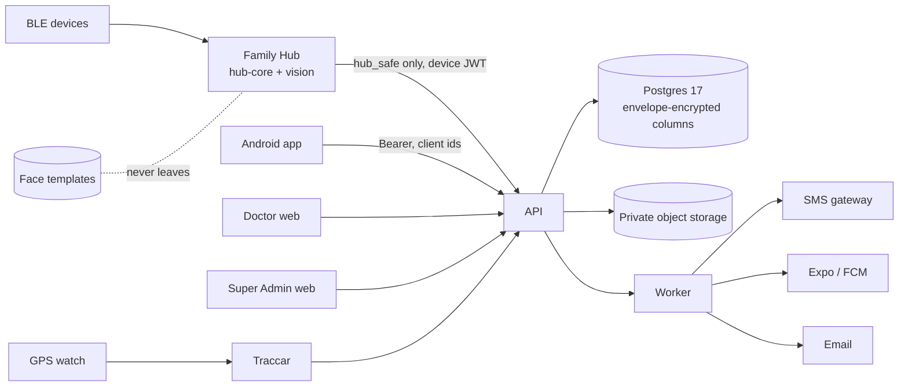

# Cure Global — Data protection impact assessment (DPIA)

*v1.0 draft · 23 Oct 2026 · Phase 6 (E14-08). The assessment the PDPA No. 9 of 2022 requires before high-risk processing starts, laid out like GDPR Art. 35(7). It describes the system **as built** (migrations 0001–0006, plus the P6 retention and DSAR work in 0009), not the plan. Inputs: `PRIVACY_CONSENT_SECURITY.md` (consent model, controls), `DATA_MODEL.md` §8 and §10–14, `ACCESS_CONTROL.md`, `THREAT_MODELS.md`, `ROPA.md`. **Status: draft for DPO review. Real personal data must not be processed until §9 is signed** (STANDARDS_AND_REGULATIONS.md §5: DPIA v1 approved before the pilot). Not legal advice: ⚠ marks points for counsel.*

## 0. Document control

| Item | Value |
|---|---|
| Controller | ⚠ legal entity to confirm (Cure Health Care International (Pvt) Ltd or a Cure Global entity), address, registration no. |
| DPO | ⚠ to be appointed (external allowed, E14-08); contact address |
| Assessors | Engineering lead, product owner, Clinical Safety Officer (CSO), DPO |
| Scope | Cure Global platform: API + worker, Super Admin web, Doctor web, Family Hub (hub-core, vision, ble-gateway, hub-ui), Android app, integrations (SMS, push, email, Traccar, Health Connect, FHIR export, share links). Pilot: 50–100 families, 5–10 doctors, Sri Lanka (`ROADMAP.md` Pilot) |
| Not in scope | Research or secondary use (none in the MVP; would need its own DPIA), billing (R3), HMS connector (R3), FHIR read API / SMART (R3) — each gets an addendum before release |
| Review | Before the pilot; then yearly, on every material change (new data category, processor, country, export path), and after any breach |

### 0.1 Why a DPIA is required

| Trigger | Here |
|---|---|
| Special-category data at scale | Health data for whole families, lifelong (`PRIVACY_CONSENT_SECURITY.md` §1) |
| Children | All of a child's personal data is special-category under the PDPA (under 16); infants to teens are core users |
| Biometrics | Face templates on the Family Hub (kept on the hub only) |
| Location / tracking of vulnerable people | GPS watches and geofences for elders and children with special needs (R2) |
| Vulnerable data subjects | Elders who may lack capacity, teens, pregnant women, children with disabilities |
| Systematic monitoring | Alerts on readings, missed check-ins, inactivity watch |
| New technology | Shared household device with face recognition |
| Cross-border transfer | Possible, depending on hosting decision D-4 |

⚠ Counsel: cite the PDPA section(s) and any DPA rules that make the DPIA mandatory and say whether it must be filed or only kept ready "on request".

## 1. Description of the processing

### 1.1 Purposes

1. Keep one lifelong health record per person (readings, conditions, medicines, vaccines, growth, documents, notes).
2. Let a family see and manage the records it is allowed to see (guardianship for dependants; grants for adults).
3. Let the doctors on a person's care team view data in their categories, set targets and alert rules, write notes and messages.
4. Show hub-safe information on a shared Family Hub and take readings there.
5. Send alerts and reminders (check-ins, SOS, doctor thresholds, safety-net bands) to carers and care teams.
6. Run the service: support, audit, security, backups, aggregate statistics without identities.

### 1.2 Processing per entry point

| Entry point | Who uses it | Personal data it handles | Flows |
|---|---|---|---|
| **API + worker** (`services/api`) | All surfaces; the worker runs jobs | Everything in §2 | TLS from clients; Postgres 17 (private network); Valkey (rate limits, job queue — ids only); S3-compatible object storage (documents, photos, DSAR zips); outbound SMS / push / email (fixed texts) |
| **Super Admin web** (`apps/admin-web`) | Platform staff by role (`super_admin`, `ops_support`, `dpo_auditor`, `clinical_safety_officer`, `content_manager`) | Administrative data only: names, roles, invites (masked phones), hub profiles, consent metadata, audit, DSAR queue; population aggregates with k ≥ 5 suppression. Individual clinical data only inside a break-glass session | Staff browser → API (`/api/v1/admin/*`, incl. `/api/v1/admin/break-glass/*`) |
| **Doctor web** (`apps/doctor-web`) | Verified practitioners on care teams | The categories their care-team role allows (`app/care/service.py ROLE_DEFAULTS`): vitals, notes, growth, immunisations, messages, PDFs | Doctor browser → API; SSE live updates (ids only) |
| **Family Hub** (`apps/hub-ui`, `services/hub-core`, `vision`, `ble-gateway`) | Family members at home, guests | Hub-safe modules only (`HUB_CATEGORIES`), readings from BLE devices, check-ins, SOS; **face templates and thumbnails never leave the hub** | BLE peripherals → ble-gateway → MQTT (local, opaque ids) → hub-core → `/api/v1/hub/*` (device JWT + Ed25519 proof); vision keeps templates in an AES-GCM store on the hub (`services/vision/vision/store.py`) |
| **Android app** (`apps/mobile`) | Family members with a login | The person's own data and what guardianship/grants allow; Health Connect imports (opt-in) | App → API with Bearer tokens; offline queue with client ids |
| **Integrations** | — | SMS gateway: phone + fixed text; push (Expo → FCM): token + fixed text; email: address + fixed text; Traccar (self-hosted): device positions; FHIR bundle / PDF / share links: what the policy allows | See `ROPA.md` §3 (processors) |

### 1.3 Data flow (summary)

## 2. Data inventory (as built)

Encryption legend: **E** = envelope-encrypted in the application (`app/platform/crypto.py`: per-value AES-256-GCM data key wrapped by the KEK, format `ev1.<kid>.…`, AAD = `table.column`); **H** = keyed HMAC lookup hash (`lookup_hash`, separate key) or SHA-256 of a secret; everything else relies on managed storage encryption at rest and TLS in transit.

| Context | Table | Personal data | E | H |
|---|---|---|---|---|
| identity | `user_account` | display name, phone, email, password (argon2), TOTP secret, recovery codes, login counters | `phone_enc`, `email_enc`, `mfa_totp_secret_enc`, `mfa_totp_pending_enc` | `phone_hash`, `email_hash`, recovery codes (keyed hashes) |
| | `auth_session`, `refresh_token` | device label, IP, user agent | — | `ip_hash`, `user_agent_hash`, `token_hash` |
| | `otp_challenge` | the identifier an OTP was sent to | `meta.ident_enc` | `identifier_hash`, HMAC `digest` |
| people | `person` | given/family/preferred name, date of birth, sex for clinical use, gender identity, pronouns, blood group, language, photo reference, deceased date | — | — |
| | `person_identifier` | NIC, PHN, passport, HMS display id | `value_enc` | `value_hash` |
| | `person_contact` | emergency / external care contacts (third parties): name, relationship or place, phone | `phone_enc` | — |
| family | `family`, `family_membership` | family name, member display names, avatar colour, language, hub vital kinds | — | — |
| | `guardianship` | who is guardian of whom, basis, review evidence | — | — |
| | `family_invite` | invitee phone | `phone_enc` | `phone_hash` |
| consent | `consent_record`, `consent_policy` | consent evidence: who, how (method), version, device, time | — | — |
| | `access_grant` | who may see which categories of whose data | — | — |
| | `break_glass_session` | staff requester, subject, written reason | — (`reason` is plain text, see §7 A-6) | — |
| | `teen_confidentiality_request` | teen's request for private modules | — | — |
| | `safety_restriction` | a protected person and the member restricted from them; support's note | `reason_enc` | — |
| | `capacity_decision` | capacity assessment / best-interest decision, assessor, reason | `reason_enc` | — |
| care | `practitioner` (+ verification events, roles) | doctor name, licence number, specialties | `licence_number_enc` | `licence_hash` |
| | `care_team`, `care_team_member`, `care_request` | which doctors care for whom, categories | — | `code_hash` |
| modules | `person_module`, `person_flag`, `episode`, `condition` | active modules (reveal life stage, pregnancy), flags (special needs), episodes (pregnancy data: LMP, dating, gravida/para, safeguarding status), conditions (ICD-11) | — | — |
| records | `observation` (partitioned), `observation_daily_summary`, `observation_revision` | readings (value, unit, context, source, device, who entered, how identified), daily aggregates, amendment history with reasons | — | — |
| | `tracker_entry` (partitioned) | quick logs (feeds, nappies, seizures, behaviour, sleep, cycle, mood) | — | — |
| | `target`, `allergy_intolerance`, `document` | doctor's targets, allergies, document metadata (file in private object storage under an opaque key) | — | — |
| | `review` | doctor's review message | `message_enc` | — |
| medication | `medication`, `medication_schedule`, `dose_event` | medicines, times, doses taken/missed | — | — |
| scheduling | `appointment`, `calendar_event`, `reminder` | appointments (doctor, place, queue number), family calendar | — | — |
| safety | `checkin`, `sos_event` | elder daily check-ins, SOS events | — | — |
| clinical | `clinical_note` | clinical note text and versions | `body_enc` | — |
| | `clinician_tag` | a clinician's private risk tags for a person | — | — |
| alerts | `alert`, `alert_event`, `alert_rule`, `escalation_chain` | alert firing data (**includes a copy of the reading**), who acknowledged, the family's escalation order | — | — |
| notifications | `notification`, `notification_delivery`, `push_token` | recipient, template code, params (ids/counts), delivery status, push token | `push_token.token_enc` | `token_hash` |
| child | `birth_record`, `immunization`, `milestone_check`, `growth_setting` | birth details, vaccines, developmental milestones | — | — |
| devices | `hub_device`, `hub_heartbeat`, `device_event_log` | hub bound to a family, telemetry (no PHI), events with ids/counts | — | — |
| | `hub_pairing_code`, `hub_auth_nonce`, `hub_refresh_token`, `hub_guest_claim` | short-lived secrets; a guest's single reading for 15 minutes | — | `code_hash`, `nonce_hash`, `token_hash` |
| messaging | `message_thread`, `message`, `message_read` | messages between family and care team | `subject_enc`, `body_enc` | — |
| questionnaires | `questionnaire_assignment`, `questionnaire_response` | answers, clinician-only score | `note_enc`, `answers_enc` | — |
| sharelinks | `share_link` | link label, scope, snapshot of modules, access count | — | `token_hash` |
| platform | `outbox_event` | ids only | — | — |
| | `dsar_request` (+ 0009 columns) | data-subject requests, handling notes (never health data) | — | — |
| | `audit_event` (partitioned, hash-chained) | who accessed whose data, purpose, basis; ids and counts only in `details` | — | `ip_hash`, `user_agent_hash` |
| | `legal_hold`, `retention_run` (0009) | holds that stop erasure; retention run reports (counts) | — | — |
| **Object storage** | `persons/{id}/documents/{id}`, photos, DSAR export zips | documents (EXIF stripped, scanned), profile photos, DSAR packages | Bucket encryption; links short-lived and signed | — |
| **Hub (local)** | vision store, hub-core cache | face templates and one face thumbnail per member (AES-256-GCM, key from `VISION_TEMPLATE_KEY`, TPM-sealed in production, LUKS partition); local reading queue | On-device | — |
| **Traccar** | positions | raw GPS positions (self-hosted) | Disk encryption | — |

## 3. Necessity and proportionality

| Category | Why it is needed | Minimisation as built | Retention (§8 of `DATA_MODEL.md`, enforced by `app/privacy/retention.py`) |
|---|---|---|---|
| Identity & contact | Sign-in (phone OTP, email + TOTP for staff), invitations, emergency contacts | Phones/emails encrypted and looked up by keyed hash; consoles show masked phones; no address collected yet | Account life; invites expiry + 30 d; OTP challenges and sessions purged after expiry |
| National identifiers (NIC/PHN) | Matching with clinics / HMS (R3) | Optional; encrypted + hashed | With the record |
| Health records | The core purpose | Per-module data; canonical units; family surfaces show no population thresholds (ADR-0012) | Life of account + 10 y after last activity (children: to 25 or 10 y, whichever later) ⚠ counsel |
| Reproductive & mental health | Pregnancy, cycle, wellbeing modules chosen by the person | Separate explicit opt-in for family sharing; teen-confidential from 16; never on the hub without the person's own `hub_display` consent | As health records |
| Biometric (face) | Recognise who is standing at the shared hub so readings go to the right person (HZ-01) | Optional (PIN/picture alternative); on the hub only; infants never enrolled | Until consent withdrawn or member removed (deleted on hub) |
| Location | Safety for elders/children with special needs (R2) | Geofence events, not tracks; last-known position on request with notice | Raw positions ≤ 30 d in Traccar; events with the record |
| Device & usage telemetry | Hub fleet health, support | No PHI in heartbeats or MQTT topics | 30 d |
| Audit | Accountability, PDPA/GDPR accountability, breach investigation | ids and counts only | 7 y, then archive |
| Notifications | Alerts and reminders | Fixed texts, no values or condition names (`app/notifications/templates.py`, `tests/test_notification_templates.py`) | 90 d |

Data-subject rights as built: access/export (DSAR zip, §5 M-14), rectification (records amended with history; identity fields via the DSAR rectify flow), erasure with legal holds (M-15), restriction/objection (DSAR types `restrict`, `object`, handled manually by the DPO), withdrawal of consent at any time (wins everywhere), "who viewed my record" (`app/consent/access_log.py`).

## 4. Risks to individuals

Scale: likelihood (L) and severity (S) 1–5; risk = L × S. **Before** = no specific controls; **after** = controls in §5 as built. ≥ 15 high, 8–14 medium, ≤ 7 low.

| # | Risk | Harm | L×S before | Controls (§5) | L×S after | Residual |
|---|---|---|---|---|---|---|
| R-1 | **Re-identification** from aggregates or exports | Disclosure of conditions | 3×4 = 12 | M-10 k ≥ 5 suppression; M-9 no PHI in logs/telemetry; M-14 exports policy-filtered | 1×4 = 4 | Low |
| R-2 | **Family coercion / location abuse** (controlling partner or relative watches someone) | Physical and psychological harm (HZ-13) | 4×5 = 20 | M-1 grants given by the adult only and withdrawable without the admin; M-6 safety-concern flow; location consent or best-interest decision; audit + notice on location requests | 2×5 = 10 | Medium — depends on support staff recognising abuse; training (TRAINING_OUTLINES) |
| R-3 | **Teen disclosure** to guardians (reproductive health, wellbeing, confidential messages) | Psychological, social harm (HZ-12) | 4×5 = 20 | M-4 teen-confidential on every path, no trace to guardians; access-matrix tests over REST/FHIR/PDF/notifications/hub; DSAR export as the requester | 1×5 = 5 | Low |
| R-4 | **Elder surveillance** beyond what the elder wants | Loss of autonomy, dignity | 3×3 = 9 | M-1 adult's own grants; capacity decisions recorded with assessor and review date (`capacity_decision`); best-interest only for listed purposes; check-in needs an explicit tap (HZ-09) | 2×3 = 6 | Low |
| R-5 | **Biometric misuse** (face data copied, reused, leaked) | Permanent loss of a biometric | 3×5 = 15 | M-8 templates never leave the hub, AES-GCM with member-bound AAD, TPM-sealed key, LUKS; consent per member, guardian for children, infants never enrolled; "Forget me" deletes at once | 1×5 = 5 | Low |
| R-6 | **Breach** of the central database or storage | Disclosure at scale | 3×5 = 15 | M-7 envelope encryption for identifiers, contact data, notes, messages, answers; private network; least-privilege roles; audit chain; encrypted backups; MFA for staff; `BREACH_PROCEDURE.md` | 2×5 = 10 | Medium — names, DOB and readings are protected by storage encryption only (A-3) |
| R-7 | **Wrong attribution** of a reading to another person (shared hub) | Wrong clinical decisions; disclosure to the wrong family member | 4×4 = 16 | Attribution engine + inbox for uncertain readings (HZ-01), proxy chooser confirmation, `identified_by` shown to doctors, plausibility checks | 2×4 = 8 | Medium — pilot attribution audit ≥ 98 % |
| R-8 | **Break-glass misuse** by platform staff | Unjustified access to a record | 3×4 = 12 | M-5 written reason, ≤ 60 min, second approver or flagged emergency mode, every read audited with `purpose=break_glass`, family notified, DPO review within 2 working days | 1×4 = 4 | Low |
| R-9 | **Cross-border transfer** without safeguards | Loss of PDPA protection | 3×4 = 12 | Hosting decision D-4 (region variable in `infra/tofu`); transfer instrument if outside Sri Lanka; processor contracts | ⚠ 2×4 = 8 until D-4 decided | Medium — open |
| R-10 | **Over-retention** | Larger breach impact, unlawful retention | 4×3 = 12 | M-12 retention jobs with dry-run report and legal holds | 2×3 = 6 | Low once the schedule is approved |
| R-11 | **PHI in notifications** on lock screens / shared phones | Disclosure to bystanders | 4×3 = 12 | M-11 fixed texts, no values or conditions; only `{name}` (family display name) and `{count}` | 2×2 = 4 | Low — the display name itself appears (A-8) |
| R-12 | **Hub shows sensitive data** in a shared room | Disclosure to household and visitors | 4×4 = 16 | M-3 `hub_safe` + `HUB_CATEGORIES`; `hub_opt_in` only with the person's own `hub_display` consent | 1×4 = 4 | Low |
| R-13 | **Doctor sees more than needed** | Disclosure beyond care need (HZ-16) | 3×3 = 9 | Care-team categories per role, coverage checks, audited reads | 2×3 = 6 | Low |
| R-14 | **Account takeover** (SIM swap, phished OTP) | Disclosure of a family's data | 3×4 = 12 | OTP HMAC-bound, 5 attempts, rate limits; refresh-token reuse detection; sessions list and revoke; app lock | 2×4 = 8 | Medium — SIM-swap is outside our control; passkeys later |

## 5. Measures as built (with code pointers)

| # | Measure | Where |
|---|---|---|
| M-1 | **One access policy, deny by default**; every allow audited with basis and purpose | `services/api/app/consent/policy.py` (pure `Policy.decide`), `services/api/app/consent/service.py` (`access_context`, `authorize`, `authorize_many`); `tests/test_policy*.py`, `tests/test_access_api.py` (access matrix) |
| M-2 | **Consent first, withdrawal wins**: purpose-specific, versioned, method recorded (self, guardian, assisted, best-interest proxy); withdrawal revokes dependent grants in the same transaction; family sharing presets with reproductive/mental health as separate opt-ins | `services/api/app/consent/sharing.py` (`PURPOSES`, `METHODS`, `resolve_method`, withdrawal), `services/api/app/consent/capacity.py` |
| M-3 | **Hub minimisation**: only `hub_safe` modules in `HUB_CATEGORIES`; `hub_opt_in` modules only with an active `hub_display` consent (teen-confidential: the teen's own) | `packages/module-catalogue/python/cure_catalogue/categories.py`, `services/api/app/consent/service.py` (hub opt-ins), `services/api/app/devices/contract.py`; ADR-0011 |
| M-4 | **Teen confidentiality** 16–17 by catalogue flag on every path; 13–15 opt-in approved by a doctor; guardians see no trace | `services/api/app/consent/policy.py`, `services/api/app/consent/teen.py`; `tests/test_policy_r2a.py`, `tests/test_r2a_consent.py` |
| M-5 | **Break-glass**: reason ≥ 20 chars, ≤ 60 min, second approver or emergency mode flagged for DPO, `purpose=break_glass` on every read, family notified, DPO review | `services/api/app/api/break_glass.py`; `tests/test_break_glass_api.py` |
| M-6 | **Safety-concern flow**: hides a person's data and location from named members at once, confidentially | `services/api/app/consent/safety_concern.py`, `POST /api/v1/admin/persons/{id}/safety-concern` |
| M-7 | **Envelope encryption** of sensitive columns and **keyed lookup hashes**; KEK rotation script | `services/api/app/platform/crypto.py`, `services/api/scripts/rotate_kek.py` |
| M-8 | **Face data never leaves the hub** | `services/vision/vision/store.py` (AES-256-GCM, AAD `member_id|kind`), Cure Home rule 1 |
| M-9 | **No PHI in logs**: structured JSON logs with a scrubber (phones, emails, NIC, names/values keys, SQL parameters); request bodies and query strings never logged; log-scan test drives sign-in, readings, notes, alerts and exports and asserts nothing personal appears | `services/api/app/platform/logs.py`, `services/api/tests/test_log_scan.py` |
| M-10 | **Aggregates only for platform staff**, k ≥ 5 suppression | `services/api/app/analytics/suppression.py`, `services/api/app/analytics/readings.py` |
| M-11 | **Notification texts without values, conditions or sensitive module names**; tests scan every text in every language | `services/api/app/notifications/templates.py`, `tests/test_notification_templates.py` |
| M-12 | **Retention jobs** per `DATA_MODEL.md` §8 with a dry-run report; legal holds respected; purges of outbox, events, notifications, heartbeats, nonces, pairing codes, refresh tokens, invites | `services/api/app/privacy/retention.py` (`python -m app.privacy.retention --dry-run`; `GET /api/v1/admin/retention/report`, `POST /api/v1/admin/retention/run`); tables `retention_run`, `legal_hold` (migration 0009) |
| M-13 | **Audit chain**: hash-chained, append-only (no UPDATE/DELETE for the app role), verified nightly and on demand | `services/api/app/audit/service.py`, worker `verify_audit_chain`, `POST /api/v1/admin/audit/chain/verify` |
| M-14 | **DSAR export**: zip of FHIR R4 bundle + PDF summary + audit extract, built **as the requester** through the access policy (a teen's confidential data goes only to the teen), short-lived signed link | `services/api/app/privacy/dsar.py`, `services/api/app/exports/fhir.py`, `services/api/app/exports/pdf.py` |
| M-15 | **Rectify and erase with legal holds**, SLA tracking (1 month, extendable once) | `services/api/app/privacy/dsar.py`, `services/api/app/api/admin.py` (DSAR queue) |
| M-16 | **Exports filtered record by record** and audited as `export`; staff cannot export outside break-glass | `services/api/app/api/exports.py` |
| M-17 | **Share links**: time-limited, read-only, token hashed, revocable, audited | `services/api/app/sharelinks/service.py` |
| M-18 | **Documents**: private bucket, opaque keys, EXIF stripped, content sniffed, virus scan, short-lived links | `services/api/app/platform/storage.py`, `services/api/app/platform/scan.py` |
| M-19 | **Identity**: EdDSA 15-min access tokens, rotating refresh tokens with reuse detection, `tokens_valid_after` revocation, mandatory TOTP for doctors/staff, OTP HMAC-bound with attempt limits, rate limits | `services/api/app/identity/*`, `services/api/app/platform/ratelimit.py` |
| M-20 | **Transparency**: "who viewed my record" | `services/api/app/consent/access_log.py` |
| M-21 | **Backups encrypted**, restore drill | `scripts/backup.sh` / `.ps1`, restore drill (`docs/06-operations/RUNBOOK.md`) |
| M-22 | Threat models, ASVS/MASVS mapping, scanner results | `THREAT_MODELS.md`, `ASVS_MASVS_ASSESSMENT.md`, `SECURITY_ASSESSMENT.md` |

## 6. Residual risk

With the measures above, no risk remains **high**. Medium residual risks: R-2 family coercion (people-dependent), R-6 breach of unencrypted health columns, R-7 wrong attribution, R-9 cross-border transfer (open decision), R-14 account takeover. They are acceptable for a supervised pilot with synthetic-data rehearsal first, provided the action plan items marked **before pilot** are done.

⚠ Prior consultation with the Data Protection Authority: needed only if a high residual risk remains (GDPR Art. 36 analogue) — counsel to confirm the PDPA position.

## 7. Open findings and action plan

| # | Finding | Action | Owner | When |
|---|---|---|---|---|
| A-1 | Consent texts are placeholders (`app/seed.py` POLICIES: en placeholder, si/ta `None`) | Final wording by counsel, si/ta by native-speaker clinicians; `CONSENT_TEXT_REVIEW_CHECKLIST.md` | Counsel, DPO | Before pilot |
| A-2 | Hosting region and transfer instrument (D-4) | Decide; if outside Sri Lanka, transfer instrument + update `ROPA.md` §4 | Dilshan, counsel | Before real data |
| A-3 | Names, DOB, readings, episodes, conditions and `alert.firing` are not application-encrypted | Accept with managed storage encryption + private network, or extend envelope encryption to `person` names and free-text fields; decide with the threat model | Engineering, DPO | Decision before pilot |
| A-4 | `scripts/rotate_kek.py` re-wraps only identity/contact columns; `clinical_note.body_enc`, `review.message_enc`, `message.body_enc`, `message_thread.subject_enc`, `questionnaire_*_enc`, `safety_restriction.reason_enc`, `capacity_decision.reason_enc`, `push_token.token_enc`, `otp_challenge.meta.ident_enc` are not in its list | Add them, so an old KEK can actually be retired after a rotation (breach containment) | Engineering | Before pilot |
| A-5 | `alert.firing` keeps a copy of the reading | Include in erasure and retention (with the record) | Engineering | With M-15 |
| A-6 | `break_glass_session.reason` is plain text written by staff and may contain health details | Guidance in training ("no clinical details in the reason") or encrypt | DPO, engineering | Before pilot |
| A-7 | Raw Traccar positions ≤ 30 d is a policy, not yet configured | Configure Traccar position history purge (`database.historyDays` ⚠ verify key name) in compose/IaC when GPS ships (R2) | Engineering | With E11-04 |
| A-8 | Notification texts carry the family display name (`{name}`) | Keep (needed to act on an alert) but let families choose a neutral display name; document in the privacy notice | Product | Before pilot |
| A-9 | The Android app's legal texts (`apps/mobile/src/legal/documents.ts`) still describe the Cure Patient app (no location, Cure visits) | Rewrite with the mobile rebrand (E16-01); align with this DPIA | Product, counsel | Phase 2 (app) |
| A-10 | Hub consent strings say "Cure Home" and "Others in the family cannot see them" (`packages/i18n/src/*.ts` `cons.*`) — inaccurate where family admins see readings through grants | Reword for Cure Global (see checklist) | Product, clinicians | Before pilot |
| A-11 | Processor agreements (cloud, SMS, Expo/FCM, email) | Sign DPAs; list in `ROPA.md` §3 | Counsel | By 1 Jan 2027 |
| A-12 | Privacy notice en/si/ta (plain language) | Write from `ROPA.md` | Counsel, DPO | Before pilot |
| A-13 | Restriction/objection requests are handled manually | Runbook step in the DSAR SOP; system support later | DPO | Before pilot |
| A-14 | Re-consent at 16/18 and policy material changes rely on next sign-in | Monitor `GET /api/v1/admin/consent-policies/reconsent` monthly | DPO | Ongoing |

## 8. Consultation

| Who | How | When | Outcome |
|---|---|---|---|
| Families (pilot cohort: elders, parents, pregnant women, teens with guardians' agreement) | Formative usability sessions incl. "What can the family see?" and hub consent screens | Phase 6 | ⚠ to record |
| Doctors (5–10 pilot) | Interviews on care-team scopes and break-glass expectations | Phase 6 | ⚠ |
| CSO | Hazard log review (HZ-01, HZ-09, HZ-12, HZ-13, HZ-19) | Phase 6 | ⚠ |
| Counsel | Lawful bases, retention, transfers, DPA notification deadline | Phase 6 | ⚠ |
| Security reviewer / pen-test vendor | `PEN_TEST_PLAN.md` | Before pilot | ⚠ |

## 9. DPO opinion and sign-off

**DPO opinion** (to be written by the DPO): ________________________________________________

| Role | Name | Decision (approve / approve with conditions / reject) | Date | Signature |
|---|---|---|---|---|
| Data Protection Officer | | | | |
| Clinical Safety Officer | | | | |
| Engineering lead | | | | |
| Management (residual risk accepted) — Dilshan | | | | |

Conditions attached to approval: ____________________

## 10. Change log

| Version | Date | Change |
|---|---|---|
| 0.1 | 22 Oct 2026 | DPIA plan in `PRIVACY_CONSENT_SECURITY.md` §4 |
| 1.0 draft | 23 Oct 2026 | Full draft from the as-built system (Phase 6) |
