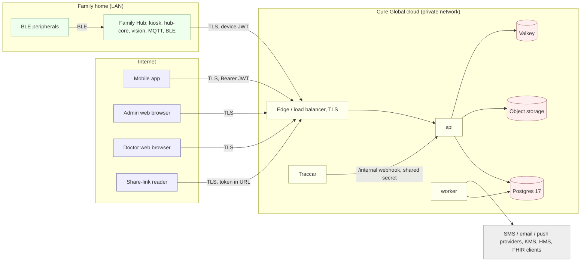
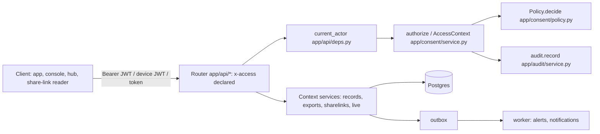
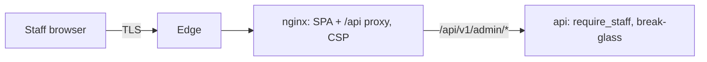
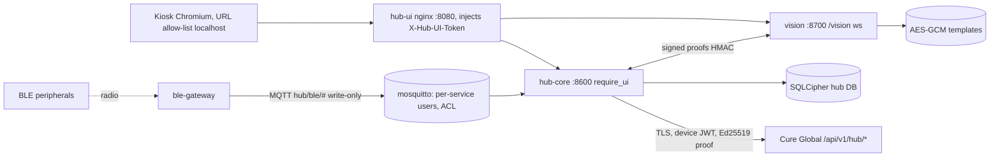

# Cure Global — Threat models (STRIDE)

*v1.0 draft · 23 Oct 2026 · One STRIDE threat model per surface: API, Super Admin web, Doctor web, Family Hub, mobile app and integrations (E14-05). Controls point at the code as built (`path:symbol`); residual risk is after those controls. Method: STRIDE per element and per trust boundary, as IEC 81001-5-1 §5.2 asks. Reviewed per release (§9). Scanner results: [`SECURITY_ASSESSMENT.md`](SECURITY_ASSESSMENT.md). ASVS/MASVS mapping: [`ASVS_MASVS_ASSESSMENT.md`](ASVS_MASVS_ASSESSMENT.md). External test: [`PEN_TEST_PLAN.md`](PEN_TEST_PLAN.md).*

## 1. Scope, assets and threat actors

### 1.1 Assets

| Id | Asset | Where | Why it matters |
|---|---|---|---|
| A1 | Health records (observations, trackers, notes, documents, medicines, vaccines) | API DB (partitioned), object storage | Special-category data (PDPA); clinical decisions depend on integrity |
| A2 | Teen-confidential and sensitive-category data (reproductive health, wellbeing, confidential messages) | API DB | Disclosure to a guardian is HZ-12 harm |
| A3 | Credentials and tokens: passwords, OTPs, TOTP secrets, recovery codes, refresh tokens, device keys, share-link and stream tokens | API DB (hashed/encrypted), browsers, phones, hubs | Account takeover |
| A4 | Face templates and thumbnails | Hub only (`services/vision`) | Biometric data; Cure Home rule 1 |
| A5 | Location (geofence events; raw positions in Traccar) | API DB, Traccar | Family-abuse risk (HZ-13) |
| A6 | Audit chain | `audit_event` partitions | Evidence for DSARs, break-glass review, incidents |
| A7 | Keys: KEK, lookup-hash key, JWT signing key, `HUB_DB_KEY`, `VISION_TEMPLATE_KEY`, `HUB_UI_TOKEN`, `VISION_HUB_SECRET` | Env/secret store, hub | Everything else depends on them |
| A8 | Catalogue rules (modules, flags, plausible/urgent bands, schedules) | `packages/module-catalogue`, `catalogue_release` | Wrong flags leak data or hide urgent values |
| A9 | Availability of alerts, check-ins and SOS | API, worker, notification providers, hub | HZ-09, HZ-17 |

### 1.2 Threat actors

| Id | Actor | Typical goal |
|---|---|---|
| T-EXT | External attacker on the internet | Account takeover, bulk data theft, ransom |
| T-FAM | Curious or controlling family member (partner, guardian of a teen, adult child of an elder) | Read data they were not granted; track location |
| T-CLIN | Clinician outside the care team or beyond their categories | Browse records |
| T-STAFF | Platform staff (support, ops) acting beyond their role | Read PHI without break-glass |
| T-LAN | Someone on the family's Wi-Fi, or a visitor at the hub | Read another member's data from the shared screen; inject readings |
| T-THEFT | Thief of a phone, laptop or hub | Use stored sessions |
| T-SUPPLY | Compromised dependency, CI action, SMS/push provider | Code execution, message interception |

### 1.3 Residual-risk scale

**L** — accepted, monitor. **M** — action planned before the pilot or by the release named. **H** — must be fixed before real data (pilot go/no-go, `ROADMAP.md` Phase 6 exit).

### 1.4 System context and trust boundaries

Trust boundaries: **B1** internet ↔ edge (every client is untrusted); **B2** edge ↔ api (only `/api/v1/*`; `/internal/*` and `/metrics` are not routed); **B3** api/worker ↔ data stores (private network, credentials from the secret store); **B4** home LAN ↔ hub services (only the kiosk on loopback may call hub-core and vision); **B5** BLE radio ↔ hub (any nearby device can advertise); **B6** cloud ↔ third-party providers.

## 2. API (`services/api`)

| Id | Threat | Existing control (code) | Residual | Action / owner |
|---|---|---|---|---|
| TM-API-S1 | Credential stuffing or brute force on `/auth/login` | Argon2id (`app/identity/passwords.py:hash_password`); lockout with doubling backoff (`app/identity/service.py:password_login`); per-identifier and per-IP windows (`app/platform/ratelimit.py:LOGIN_PER_IDENTIFIER`, `LOGIN_PER_IP`); one answer for unknown account and wrong password, dummy hash for timing (`passwords.py:_DUMMY`); tests `tests/test_auth_api.py::test_wrong_password_then_lockout` | M | Per-IP limit counts the proxy's address (TM-API-D3). Raise minimum length to 12 and add an online breached-password check (ASVS 2.1.1, 2.1.7) — Eng, before pilot |
| TM-API-S2 | OTP brute force, SMS pumping (toll fraud) | 6-digit code kept only as an HMAC bound to the challenge id (`identity/service.py:_otp_digest`); 5 attempts, 10 min, single use (`verify_otp`); 3 codes per identifier per 10 min, 20 per IP per hour (`ratelimit.py:OTP_PER_IDENTIFIER`, `OTP_PER_IP`); test `test_otp_attempts_and_rate_limit` | M | Restrict the SMS provider to LK numbers, daily spend alarm, app attestation / CAPTCHA on `otp/request` when abuse is seen — Ops + Eng, before pilot |
| TM-API-S3 | Takeover of a doctor or staff account | Mandatory TOTP; no tokens until the second factor (`identity/service.py:actor_for_account`, `mfa_step`); MFA step token 5 min, typed `mfa`; recovery codes keyed-hashed, single use (`check_second_factor`); MFA attempts 10 / 5 min per account (`app/api/auth.py` `/auth/mfa/verify`); tests `test_doctor_needs_totp_and_acts_as_practitioner`, `test_staff_token_without_mfa_is_refused` | M | A TOTP code can be replayed inside its 90 s window (`identity/totp.py:verify`, ASVS 2.8.4); no notice to the user when the password, TOTP or recovery codes change (ASVS 2.2.3, 2.5.5); TOTP is phishable — passkeys/WebAuthn for staff (ASVS 2.2.4) — Eng, before pilot (replay + notices), R2 (passkeys) |
| TM-API-S4 | Forged or confused tokens (alg confusion, step token used as access token) | EdDSA only, keys looked up by `kid`, required claims, `typ` separation (`app/identity/tokens.py:decode`); production refuses a derived signing key (`tokens.py:signing_key`); tests `tests/test_security_unit.py::test_step_tokens_cannot_be_used_as_access_tokens`, `::test_tokens_signed_by_another_key_are_refused` | L | — |
| TM-API-S5 | Stolen refresh token reused | Rotation with reuse detection that ends the whole session (`identity/service.py:refresh`); session state checked on every access token (`actor_from_access_token`); `tokens_valid_after` on password change; staff 12 h idle / 7 d max; test `test_password_login_refresh_rotation_and_reuse`, `test_password_reset_revokes_every_session` | L | Staff/clinician session lifetime exceeds ASVS L3 3.3.2 (see TM-DOC-S2) |
| TM-API-S6 | Dev back doors reachable outside dev: `X-Dev-Actor`, `/auth/dev/login`, anonymous dev super admin | Read only when `APP_ENV` is dev/test (`app/api/deps.py:current_actor`; `app/api/dev.py`; `app/api/hubs.py:dev_hub_owner`); tests `test_dev_quick_sign_in_only_in_dev`, `test_dev_pairing_helper_is_dev_only` | **H** | `Settings.app_env` **defaults to `dev`** and `dev_anonymous_admin` to `True` (`app/config.py:Settings`): a deployment that forgets `APP_ENV` serves every unauthenticated caller as super admin. Make the default fail-safe (`production`), refuse to start in dev unless bound to loopback / explicitly allowed, and have the deploy pipeline assert `/api/v1/health` `env` — Eng, **before any non-local deployment** |
| TM-API-S7 | Forged Traccar webhook creates location events | Shared secret header compared in constant time; `/internal` not in OpenAPI and not routed by the edge (`app/api/internal.py:traccar_event`) | M | Static secret, no timestamp: add HMAC over body + timestamp and network ACL (Traccar node only) when E11-04 lands — Eng, R2 |
| TM-API-T1 | Read or write another person's record by changing an id (IDOR) | One policy, deny by default (`app/consent/policy.py:Policy.decide`); every PHI route through `access_context` / `authorize_many` (`app/consent/service.py`); every route declares `x-access` and CI fails otherwise (`tests/test_routes.py::test_every_route_declares_its_access_policy`); access matrix (`tests/test_policy.py`, `tests/test_access_api.py`) | L | Keep matrix cases per epic (TEST_STRATEGY §3.2) |
| TM-API-T2 | Mass assignment, malformed or implausible input | Pydantic v2 models with explicit fields and limits (e.g. batches ≤ 50 items, `app/api/schemas_records.py`); catalogue `plausible` ranges (twin TS/Python, HZ-14) | L | Schemathesis fuzzing nightly (TEST_STRATEGY §1) |
| TM-API-T3 | Audit trail altered by someone with database access | SHA-256 hash chain under one advisory lock (`app/audit/service.py:record`); nightly verification with the result shown in admin (`app/worker.py:verify_audit_chain`, `app/api/admin.py` `/admin/audit/chain`) | M | The app connects as the database owner — the "INSERT/SELECT only on audit partitions" role of PRIVACY_CONSENT_SECURITY §5.4 is not implemented; the chain head is not anchored outside the DB, so an owner could rewrite a suffix consistently. Separate least-privilege app role (migration + `infra/tofu`), daily export of the chain-head hash to object-locked storage — Eng + Ops, before pilot |
| TM-API-T4 | Lost updates on shared records | `row_version` + `ETag`/`If-Match` on mutable resources (API_DESIGN §1) | L | — |
| TM-API-R1 | A clinician or staff member denies having read a record | Every allow audited with actor, basis, purpose, ip hash (`consent/service.py:AccessContext.audit`); "who viewed my record" (`app/consent/access_log.py`); audit `details` ids and counts only | L | — |
| TM-API-R2 | Break-glass used without justification | Reason ≥ 20 characters, ≤ 60 min, second approver (never self), emergency mode flagged, family notified, DPO review (`app/api/break_glass.py`); tests `tests/test_break_glass_api.py` | L | DPO reviews every session within 2 working days (PRIVACY_CONSENT_SECURITY §5.5) — DPO |
| TM-API-I1 | Teen-confidential data reaches a guardian (HZ-12) | Module flags applied whatever the category (`consent/policy.py`); FHIR and PDF filtered record by record (`app/exports/fhir.py`, `app/exports/pdf.py`); SSE decided per event (`app/live/streams.py`); access log hides confidential events from guardians (`consent/access_log.py`); tests `tests/test_exports_api.py::test_fhir_export_respects_teen_and_pregnancy_confidentiality`, `::test_pdf_report_respects_confidentiality`, `tests/test_hub_contract.py::test_teen_confidential_and_sensitive_data_never_reach_the_hub`; DSAR export is built as the requester (`app/privacy/dsar.py`) | L | Every new export path gets matrix cases (CLAUDE.md rule 2) |
| TM-API-I2 | PHI in application logs | JSON logging with a scrubber; uvicorn's access log replaced by route-template lines without query strings (`app/platform/logs.py`); log-scan test (`tests/test_log_scan.py`); SMS log masks numbers (`app/platform/messaging.py:send_sms`) | M | `SMS_BACKEND` defaults to `dev` in **every** environment and the dev backend logs the full text, OTP code included (`messaging.py:send_sms`). Refuse `sms_backend=dev`/`push_backend=dev` outside dev/test at start-up — Eng, before pilot. Console nginx logs: TM-ADM-I2 |
| TM-API-I3 | Database dump or backup exposes identifiers and notes | Envelope encryption with column AAD for phone, email, NIC, licence, TOTP, notes, messages, reasons (`app/platform/crypto.py:encrypt`); keyed lookup hashes (`lookup_hash`); KEK rotation (`services/api/scripts/rotate_kek.py`); encrypted backups (`scripts/backup.sh`, `scripts/backup.ps1`) | M | The KEK is still an environment secret everywhere (`crypto.py:root_secret`); KMS-wrapped KEK (E14-02) via `infra/tofu` — Eng + Ops, before pilot. Observation values rely on managed-DB encryption at rest (by design) |
| TM-API-I4 | Share-link token leaks (logs, browser history, forwarding) | Token stored as SHA-256, expiry, revocation, policy re-decided on every read, per-IP rate limit, `no-store` (`app/sharelinks/service.py`, `app/api/sharelinks.py`); tests `tests/test_r2a_sharing.py::test_the_policy_is_decided_again_at_read`, `::test_shared_view_is_rate_limited` | M | The token is in the URL path, so edge/proxy access logs record it: strip `/shared/*` paths from edge logs (or move the token to the fragment) — Eng + Ops, before pilot |
| TM-API-I5 | SSE stream token in the query string | 60-second, single-purpose `typ=stream` token (`app/live/streams.py:stream_token`); session re-checked at connect | L | A revoked session keeps an open stream until it ends (≤ 30 min): re-check the session each poll — Eng, R2 |
| TM-API-I6 | Errors leak internals | RFC 9457 problems (`app/core/problems.py:install`); `/docs` dev only, OpenAPI off in production (`app/main.py:create_app`) | L | — |
| TM-API-I7 | Account enumeration | Same answer for login and reset; dummy hash | L | `/auth/register` says `account-exists` — only after proving the number by OTP |
| TM-API-I8 | Malicious or metadata-laden uploads | Content sniffing (`app/platform/storage.py:sniff_document`), EXIF/XMP stripping (`strip_metadata`), clamd fail-closed (`app/platform/scan.py`), size cap (`records/documents.py`), private bucket, 5-minute signed links; tests `test_jpeg_exif_is_stripped`, `test_png_text_chunks_are_stripped` | L | Staging/production must set `VIRUS_SCANNER=clamd` (`infra/tofu`) — Ops |
| TM-API-I9 | Metrics leak identities | Route templates only, no ids or PHI in labels, token-protected, not in OpenAPI (`app/platform/metrics.py`) | L | Edge never routes `/metrics` — Ops |
| TM-API-D1 | Flooding the unauthenticated routes | Fixed windows in Valkey with an in-process fallback (`ratelimit.py`); per-device limits for hubs (`app/devices/config.py:hub_requests_per_minute`) | M | WAF/edge rate limits in front (`infra/tofu`) — Ops, before pilot |
| TM-API-D2 | Expensive requests (exports, long series, big lists) | Series ≤ 200 points; cursor pages ≤ 200; FHIR ≤ 5 000 observations (`exports/fhir.py:MAX_OBSERVATIONS`); PDF period ≤ 366 days (`api/exports.py:report_pdf`) | M | No per-user limit on authenticated routes; the audit chain's global lock serialises writes (`docs/06-testing/PERFORMANCE.md`) — Eng |
| TM-API-D3 | Per-IP limits counted against the proxy instead of the client | `client_ip_hash` uses `request.client.host` (`app/api/deps.py:client_ip_hash`) | M | The image runs `uvicorn --proxy-headers` without `--forwarded-allow-ips` (`services/api/Dockerfile` CMD), so behind nginx/the LB every client shares the proxy's bucket. Set `FORWARDED_ALLOW_IPS` to the edge addresses — Eng + Ops, before pilot |
| TM-API-E1 | Staff read PHI | Staff get administrative categories only; PHI only inside an active break-glass session (`consent/policy.py`); exports refuse `basis=admin` (`app/api/exports.py`); admin views mask sensitive modules (`app/api/admin.py:_consent_meta`) | L | — |
| TM-API-E2 | Clinician outside the care team or beyond competence (HZ-16) | Care-team coverage and categories (`app/care/coverage.py`, `app/care/service.py:ROLE_DEFAULTS`); verification status | L | — |
| TM-API-E3 | Role switching with `X-Act-As` | Only roles the account has (`identity/service.py:actor_for_account`); test `test_act_as_must_be_a_role_the_account_has` | L | — |
| TM-API-E4 | Guardian or carer beyond their basis; controlling partner | Guardianship needs `review_status=approved` for legal guardians and proxies; safety restrictions hide a person from named members (`app/consent/safety_concern.py`, `safety_restriction`) | L | — |
| TM-API-E5 | Sensitive actions on a stale session (exports, break-glass, bulk changes) | MFA at sign-in; break-glass approval | M | Step-up re-authentication (backend-r2b, in progress) — merge before pilot |

## 3. Super Admin web (`apps/admin-web`)

| Id | Threat | Existing control (code) | Residual | Action / owner |
|---|---|---|---|---|
| TM-ADM-S1 | Phished staff credentials | Mandatory TOTP for staff; staff never act on one factor (`identity/service.py:actor_for_account`) | M | Passkeys/WebAuthn for staff (phishing-resistant) — Eng, R2 |
| TM-ADM-T1 | XSS injects script into the console | React escaping; CSP `default-src 'self'`, no inline script, `base-uri 'none'`, `form-action 'self'` (`apps/admin-web/nginx/default.conf.template`) | L | `style-src 'unsafe-inline'` remains (Tailwind runtime styles) — accept |
| TM-ADM-T2 | Clickjacking | `frame-ancestors 'none'` | L | — |
| TM-ADM-R1 | Support action denied | Every support action audited with reason (`app/api/admin.py` module docstring, `record(...)`) | L | — |
| TM-ADM-I1 | PHI shown to staff | Administrative data only; sensitive module names masked (`admin.py:_consent_meta`); population charts with k ≥ 5 suppression (`app/analytics/suppression.py`, `tests/test_security_unit.py::test_small_buckets_are_suppressed_with_complementary_suppression`); records only in break-glass with a countdown | L | — |
| TM-ADM-I2 | Identifiers in nginx access logs | — | **H** | nginx's default `access_log` records `$request` including the query string, e.g. `/api/v1/admin/families?query=<phone, email or name>` (`app/api/admin.py:admin_families` accepts them). Use a `log_format` with `$uri` (no `$args`) or turn `access_log` off for `/api/` in both console templates — Eng, before pilot (CLAUDE.md rule 7) |
| TM-ADM-I3 | Token theft from the browser | Access token in memory, refresh token in `sessionStorage` (tab-scoped), never `localStorage` (`apps/admin-web/src/auth/session.ts`) | M | XSS would still reach the tab: keep CSP strict; consider BFF cookie (`__Host-`, HttpOnly) in R3 |
| TM-ADM-I4 | Downgrade / cookie-less MITM | TLS terminates at the edge | M | HSTS (preload) at the edge; `server_tokens off` in console nginx — Ops, `infra/tofu` |
| TM-ADM-D1 | — | Edge limits | L | — |
| TM-ADM-E1 | UI-only role checks bypassed | Server-side `require_staff` on every admin route; break-glass enforced in the policy | L | — |

## 4. Doctor web (`apps/doctor-web`)

| Id | Threat | Existing control (code) | Residual | Action / owner |
|---|---|---|---|---|
| TM-DOC-S1 | Shared clinic PC: next user inherits the doctor's session | Refresh token in `sessionStorage`, gone with the tab (`apps/doctor-web/src/auth/session.ts`); 15-min access tokens | M | — |
| TM-DOC-S2 | Long-lived clinician sessions | Clinicians 12 h idle, 7 d max (`app/config.py:refresh_idle_staff_s`, `refresh_ttl_staff_s`) | M | ASVS L3 3.3.2 wants 12 h absolute / 15 min idle with 2FA: configurable per role, default 15 min idle and 12 h max for staff and clinicians — Eng, before pilot |
| TM-DOC-T1 | XSS through patient-entered text (notes, messages, tracker free text) | React escaping; same CSP as admin (`apps/doctor-web/nginx/default.conf.template`) | L | No `dangerouslySetInnerHTML` (Semgrep `p/react`, SECURITY_ASSESSMENT.md) |
| TM-DOC-I1 | Reading patients outside the panel | Panel and worklist by care-team coverage (`app/clinical/worklist.py`, `app/care/coverage.py`); per-record policy | L | — |
| TM-DOC-I2 | PHI cached by the browser or a shared proxy | Exports `Cache-Control: private, no-store` (`app/api/exports.py`); HTML `no-store` (nginx) | M | Send `Cache-Control: no-store` on every PHI JSON response (middleware) — Eng |
| TM-DOC-I3 | Live events reveal data across patients | SSE per stream and per event through the policy (`app/live/streams.py`); 60 s stream tokens | L | SSE path (`/api/v1/events?token=`) is in nginx logs: covered by TM-ADM-I2 fix |
| TM-DOC-R1 | Note authorship disputed | Notes are versioned with `amends_id`, authorship kept (`app/clinical/notes.py`) | L | — |
| TM-DOC-E1 | Nurse/therapist sets targets or alert rules | Role defaults and categories (`app/care/service.py:ROLE_DEFAULTS`) | L | — |

## 5. Family Hub (`apps/hub-ui`, `services/hub-core`, `services/vision`, `services/ble-gateway`, MQTT, kiosk)

| Id | Threat | Existing control (code) | Residual | Action / owner |
|---|---|---|---|---|
| TM-HUB-S1 | A rogue box impersonates a family's hub | Ed25519 challenge-response, single-use 60 s nonces, factory-key pinning, serial allow-list (`app/devices/service.py:pairing_start`, `challenge`, `token`; `app/devices/config.py:DeviceSettings.allows`); test `tests/test_hub_contract.py::test_wrong_key_cannot_get_a_token`, `::test_serial_must_be_on_the_allow_list_and_pairing_needs_a_family_manager` | M | Device key sealed in a TPM/secure element in production (`services/hub-core/hub_core/security.py` docstring) — Hardware, before pilot hubs ship |
| TM-HUB-S2 | Pairing code guessed or hijacked | 6 characters from 32 symbols (~10⁹), stored as SHA-256, 10 min, claim limited per person, owner/admin only (`devices/service.py:claim`) | L | — |
| TM-HUB-S3 | A device on the LAN calls hub-core or vision directly | hub-core requires the UI token (`hub_core/api/deps.py:require_ui`); vision's websocket checks it (`services/vision/vision/main.py:vision_ws`); host ports bound to 127.0.0.1 in compose | M | Vision accepts any client when `HUB_UI_TOKEN` is unset and does not require it (or `VISION_HUB_SECRET`) outside dev (`vision/config.py:VisionSettings.from_env`) — fail closed like hub-core (`hub_core/config.py`). The kiosk nginx injects the token for anyone who reaches `:8080`, so on a real hub it must listen on loopback only — Hub eng, before pilot |
| TM-HUB-S4 | A photo or screen spoofs a member's face | Only vision-signed, nonce-bound identify proofs open a session (`hub_core/api/core.py:open_session`); passive liveness heuristics (`vision/liveness.py`, "not a security boundary"); face never authorises sensitive actions (PIN or app confirmation) | M | ISO/IEC 30107-3 PAD testing before unsupervised face sign-in (STANDARDS §2) — Hub eng, R2 |
| TM-HUB-S5 | A fake BLE peripheral or compromised gateway injects readings | BLE input treated as untrusted, payloads never logged (`hub_core/engine/pipeline.py`); unknown devices refused in production (`hub_core/config.py:ble_allow_unknown`); gateways write-only on `hub/ble/#` (`infra/compose/mosquitto/acl`); server plausibility; attribution engine and inbox (HZ-01) | M | Peripheral allow-list from the catalogue (`peripherals.yaml`) — Hub eng, R2 |
| TM-HUB-T1 | Local database read or altered from a stolen disk | SQLCipher keyed from `HUB_DB_KEY`; refuses unencrypted storage when encryption is required (`hub_core/db.py`); production refuses missing secrets (`hub_core/config.py`) | M | LUKS data partition and read-only root image are Cure Home plans, not built here — Hardware |
| TM-HUB-T2 | Malicious firmware or update | — (signed A/B OTA is the Cure Home plan) | M | Signed OTA with rollback protection (ETSI EN 303 645 §5.3) — Hardware, before pilot hubs ship |
| TM-HUB-T3 | Readings altered between hub and cloud | Production requires an `https` backend and refuses the stub (`hub_core/config.py`); device JWT | L | Certificate pinning on the hub (Cure Home) |
| TM-HUB-R1 | Dispute over who measured whom | `measured_for` / `entered_by`, proxy rights decided by the server (`app/devices/ingest.py`); `device_event_log` | L | — |
| TM-HUB-I1 | Sensitive data on the shared screen | Server sends `hub_safe` modules, `hub_opt_in` only with the person's own consent (`consent/policy.py`); hub-core serves a member's data only while that member is identified (`hub_core/api/deps.py:self_only`); tests `test_teen_confidential_and_sensitive_data_never_reach_the_hub`, `test_opt_in_modules_show_only_with_the_person_s_own_consent` | L | — |
| TM-HUB-I2 | Face data leaves the hub (rule 8) | Templates and thumbnails sealed with AES-256-GCM and member AAD (`vision/store.py`); no upload path; photo passes through memory only (`hub_core/sync.py`) | L | — |
| TM-HUB-I3 | PHI on the MQTT bus or in topics | Opaque ids only (`hub_core/events.py`, `hub_core/sessions.py`); `connection_messages false` (`infra/compose/mosquitto/mosquitto.conf`) | L | MQTT is plaintext inside the hub's internal network: keep it unexposed |
| TM-HUB-I4 | Hub logs carry PHI | Bodies and tokens never logged (`hub_core/main.py`) | L | Same log-scan idea for hub-core (TEST_STRATEGY §3.7) |
| TM-HUB-I5 | Home location sent to a third party | Weather uses the configured place coordinates (`hub_core/weather.py`, `HUB_PLACE/LAT/LON`) | L | Keep coordinates at town level, never GPS of the home — Ops (provisioning checklist) |
| TM-HUB-D1 | Hub offline or API down during an emergency (HZ-17) | Offline-first queue, idempotent batches, local SOS alarm, national number shown offline | M | Chaos tests (TEST_STRATEGY §1) |
| TM-HUB-D2 | A hub floods the API | Per-device rate limit (`devices/config.py:hub_requests_per_minute`); test `test_device_routes_are_rate_limited_per_device` | L | — |
| TM-HUB-E1 | A stolen, sold or replaced hub keeps syncing | Revocation stops the next call (`devices/service.py:device_from_token`); refresh reuse revokes the chain (`devices/service.py:refresh`); tests `test_revoke_stops_sync`, `test_refresh_rotates_and_reuse_revokes_the_chain` | L | Swap-out runbook (`docs/06-operations/RUNBOOK.md`) |
| TM-HUB-E2 | Kiosk escape to the OS | Chromium URL allow-list to localhost; SSH off in production (Cure Home plan) | M | Production kiosk lockdown image — Hardware |
| TM-HUB-E3 | Dev auto-pair in production | Forced off outside dev (`hub_core/config.py`); API helper dev-only (`app/api/hubs.py:dev_hub_owner`) | L | — |

## 6. Mobile app (`apps/mobile`)

The app in the repo is still the imported patient app pointed at HMS (`src/services/api/client.ts` → `https://cure.lk/api/v1`, `/auth/refresh-token`). P2 (wave 6) repoints it at Cure Global; rows marked *P2* are the target design.

| Id | Threat | Existing control (code) | Residual | Action / owner |
|---|---|---|---|---|
| TM-APP-S1 | An unlocked or stolen phone opens the record | App lock with biometrics; a cold start begins locked (`src/components/security/AppLockGate.tsx`, `src/store/lockStore.ts`) | M | Lock after N minutes in background — Mobile, P2 |
| TM-APP-S2 | Another app hijacks pairing links | Android App Links with `autoVerify` for `https://cure.lk/hub/pair` and `/hub/claim` (`app.json` `intentFilters`) | M | The custom scheme `curepatient://` is also registered and hijackable: never accept codes or tokens on it — Mobile, P2 |
| TM-APP-T1 | Tampered offline queue on a rooted phone | Server re-validates every item (policy, plausibility); client ids make retries idempotent (CLAUDE.md rule 9) | L | — |
| TM-APP-I1 | Tokens read from storage | `expo-secure-store` (Keystore/Keychain) (`src/store/authStore.ts`) | L | — |
| TM-APP-I2 | Offline health cache read | SQLCipher with a random per-install key in SecureStore; only listed query keys persisted; cleared on sign-out (`src/services/queryClient.ts`) | L | — |
| TM-APP-I3 | Screenshots, screen recording, Recents thumbnail | `FLAG_SECURE` and iOS app-switcher blur while signed in (`src/components/security/ScreenCaptureGuard.tsx`) | L | — |
| TM-APP-I4 | Data copied by cloud/device backup | — | M | `android.allowBackup` is not disabled (`app.json`; Expo default `true`) — set `false` or exclude the cache DB — Mobile, P2 |
| TM-APP-I5 | Over-collection from Health Connect | Permissions limited to listed vitals (`app.json` `permissions`) | L | Privacy review when E16-05 adds sleep/steps — DPO |
| TM-APP-I6 | Health data on the lock screen | Notification templates carry no values or condition names (`app/notifications/templates.py`; `tests/test_notification_templates.py::test_no_banned_content_raw_or_rendered`) | L | — |
| TM-APP-I7 | Third-party SDK telemetry | No analytics/advertising SDKs (PRIVACY_CONSENT_SECURITY §3.2); Firebase only for FCM | L | SDK review gate in PRs |
| TM-APP-T2 | Payment WebView navigates to a hostile page | `onShouldStartLoadWithRequest` filter (`app/(patient)/appointments/pay.tsx`) | M | `originWhitelist` includes `https://*` with JavaScript on; legacy HMS payments — remove or restrict when billing (R3) lands — Mobile |
| TM-APP-N1 | Network interception | Platform TLS (cleartext not enabled) | M | Optional certificate pinning (MASVS-NETWORK-2) — Mobile, P2 |

## 7. Integrations

| Id | Integration | Threat | Existing control (code) | Residual | Action / owner |
|---|---|---|---|---|---|
| TM-INT-1 | Traccar (GPS, ADR-0009) | Forged events (S); raw positions retained (I); Traccar admin takeover (E) | Webhook secret (`app/api/internal.py`); positions ≤ 30 days in Traccar (DATA_MODEL §8) | M | First registered Traccar account becomes admin (`infra/compose/docker-compose.yml` comment): pre-create the admin and disable registration outside dev; HMAC + timestamp; network ACL — Ops, R2 |
| TM-INT-2 | SMS provider | SIM swap / interception of OTP and reset codes (S); message content (I) | No health data in texts (`app/notifications/templates.py`); numbers masked in logs | M | Notify the account on password reset by a second channel; staff never use SMS (TOTP) — Eng, before pilot |
| TM-INT-3 | Email (SMTP) | Spoofed mail to families (S) | Fixed templates | M | SPF, DKIM, DMARC `p=reject` on the sending domain — Ops |
| TM-INT-4 | Push (Expo, FCM/APNs) | Token theft (I); payload content (I) | Push tokens encrypted with a keyed hash (`push_token.token_enc/token_hash`, DATA_MODEL §13); payloads ids only | L | `EXPO_ACCESS_TOKEN` in the secret store — Ops |
| TM-INT-5 | HMS connector (R3, in progress) | Linking the wrong person (S); foreign data written into the record (T) | Planned: link by HMS display id + OTP, imported data marked with its source, policy on writes (BACKLOG E19-05) | M | Threat-model update when merged — Eng, R3 |
| TM-INT-6 | FHIR read API + SMART App Launch 2.2 (R3, in progress) | Over-broad scopes, token theft, confused deputy (S/I/E) | Planned: SMART scopes mapped to policy categories, PKCE, consent-aware, audited (BACKLOG E19-04) | M | Pen-test scope addition when merged — Eng, R3 |
| TM-INT-7 | Object storage | Public bucket or guessable keys (I) | Private bucket, opaque keys, SSE on https endpoints, presigned GET 5 min (`app/platform/storage.py`, `config.py:document_link_ttl_s`); versioning + encryption in `infra/tofu` | L | — |
| TM-INT-8 | KMS / secret store | KEK or JWT key leaked (I/E) | KEK rotation script; JWT key required outside dev (`identity/tokens.py:signing_key`); previous keys listed during rotation | M | KMS-wrapped KEK (E14-02) and secret-store wiring in `infra/tofu` — Ops + Eng, before pilot |
| TM-INT-9 | Backups | Theft of a dump (I); unusable restore (D) | Encrypted `pg_dump` + MinIO mirror (`scripts/backup.sh`, `scripts/backup.ps1`); restore drill (`scripts/restore_drill.ps1`) | M | Backup key held apart from the backup location; quarterly drill — Ops |
| TM-INT-10 | CI/CD and dependencies | Malicious dependency or action (T/E) | Signed images (cosign), CycloneDX SBOM, gitleaks, pip-audit, pnpm audit, Trivy, Semgrep (`.github/workflows/ci.yml`, `SECURITY_ASSESSMENT.md`) | M | Pin third-party actions by commit SHA; Dependabot/Renovate — Eng |

## 8. Open actions (consolidated)

| # | Action | Threats | Severity | Owner | When |
|---|---|---|---|---|---|
| 1 | Fail-safe `APP_ENV` default; refuse dev mode outside loopback; deploy pipeline asserts `env` — **default is now `production` (P6); loopback check and pipeline assert open** | TM-API-S6 | H | Eng | Before any non-local deployment |
| 2 | Console nginx `log_format` without query strings (both templates) — **done (P6: `cure_noargs`, `server_tokens off`)** | TM-ADM-I2, TM-DOC-I3 | H | Eng | Before pilot |
| 3 | Refuse `SMS_BACKEND=dev` / `PUSH_BACKEND=dev` outside dev/test — **SMS done (P6: refused in production; OTP text logged in dev only); push open** | TM-API-I2 | M | Eng | Before pilot |
| 4 | Least-privilege DB role (no UPDATE/DELETE on `audit_event`); anchor chain head daily in object-locked storage | TM-API-T3 | M | Eng + Ops | Before pilot |
| 5 | `FORWARDED_ALLOW_IPS` for the edge so per-IP limits see clients | TM-API-D3, TM-API-S1 | M | Eng + Ops | Before pilot |
| 6 | TOTP replay protection (last used step per account) and user notices on credential/MFA changes | TM-API-S3 | M | Eng | Before pilot |
| 7 | Staff/clinician sessions: 15 min idle, 12 h max | TM-DOC-S2 | M | Eng | Before pilot |
| 8 | KMS-wrapped KEK and secret-store wiring | TM-API-I3, TM-INT-8 | M | Eng + Ops | Before pilot |
| 9 | Vision fails closed without `HUB_UI_TOKEN` / `VISION_HUB_SECRET`; kiosk nginx on loopback only — **vision done (P6); kiosk loopback open** | TM-HUB-S3 | M | Hub eng | Before pilot hubs ship |
| 10 | Strip share-link paths from edge logs | TM-API-I4 | M | Ops | Before pilot |
| 11 | Step-up re-auth for exports, break-glass, bulk changes (backend-r2b) | TM-API-E5 | M | Eng | Before pilot |
| 12 | `Cache-Control: no-store` on all PHI responses — **done (P6: API default header, `app/platform/http_obs.py`)** | TM-DOC-I2 | M | Eng | Before pilot |
| 13 | Minimum password length 12; online breached-password check | TM-API-S1 | M | Eng | Before pilot |
| 14 | SMS provider geo-restriction and spend alarm | TM-API-S2 | M | Ops | Before pilot |
| 15 | Hub hardware: key in TPM/SE, signed OTA, LUKS + read-only root, kiosk lockdown | TM-HUB-S1, T1, T2, E2 | M | Hardware | Before pilot hubs ship |
| 16 | Mobile P2: `allowBackup=false`, no tokens on custom scheme, payment WebView restricted, optional pinning | TM-APP-* | M | Mobile | P2 |
| 17 | Passkeys for staff; PAD testing for face sign-in | TM-ADM-S1, TM-HUB-S4 | M | Eng / Hub eng | R2 |
| 18 | HSTS and WAF at the edge; pin CI actions by SHA | TM-ADM-I4, TM-API-D1, TM-INT-10 | M | Ops | Before pilot |

## 9. Review per release

1. **When:** every release that adds a route, an export path, a device interface, a third-party integration or a new data category; and at least once per quarter.
2. **Who:** engineering lead (owner), a second engineer, the DPO for privacy threats, the CSO when a threat can cause clinical harm.
3. **How:** walk the data-flow diagram for each changed surface; add or update rows; re-score residual risk; move closed actions into the row's control column with the code pointer and the test that proves it.
4. **Inputs:** the scanner run (`SECURITY_ASSESSMENT.md`), the penetration-test report (`PEN_TEST_PLAN.md`), incidents and support tickets, new hazard-log entries (`CLINICAL_SAFETY.md`).
5. **Gate:** a release with an open **H** row does not go to an environment with real data.
6. **Record:** the document's version line and a short entry below.

| Version | Date | Change | Reviewed by |
|---|---|---|---|
| 1.0 draft | 23 Oct 2026 | First models for all six surfaces | *pending: engineering lead, DPO, CSO* |
