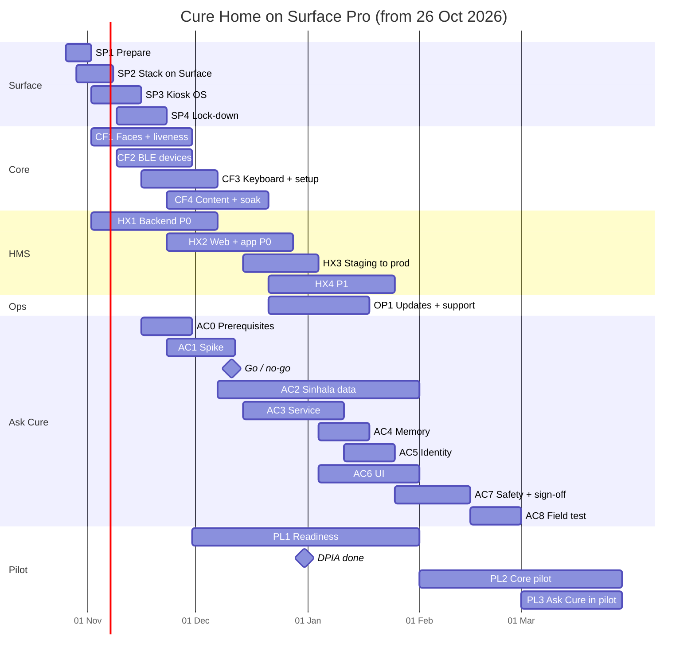

# Cure Home — Roadmap v2: Surface Pro hub, remaining features and Ask Cure

*v2.0 · 2026-10-22 · For Dilshan + Claude Code. The plan from today to a pilot, with a **Microsoft Surface Pro on Ubuntu** as the hub. Read first: `CLAUDE.md`, `docs/02-architecture/SYSTEM_DESIGN.md` (what is built), `docs/03-roadmap/HMS_AND_APP_CHANGES.md` (HMS, web and app work, items H-/W-/A-), `docs/01-product/ASSISTANT_FEASIBILITY.md` (Ask Cure).*

`ROADMAP.md` (v0.1) stays as the record of phases 0–10. This file replaces its Phase 8 (Raspberry Pi bring-up) with the Surface, picks up everything still open from SYSTEM_DESIGN §8–9 and HMS_AND_APP_CHANGES §7, and turns Phase 10 (Ask Cure) into a full build plan. The Raspberry Pi / CM5 path is kept for units that are sold later (§10).

---

## 1. Where we are (22 Oct 2026)

| Area | State |
|---|---|
| Foundation, design system, Boot, Ambient | Done |
| Camera, MediaPipe tracking, WebGL glass, Orbit View | Done on the PC |
| Face sign-in from the Cure profile photo, Who's measuring, PIN, Forget me | Built. Needs real faces to set thresholds, and **active liveness** before unsupervised use |
| Readings: BLE simulator, OKOK + GATT decoders, attribution, daily caps, inbox | Done. Real cuff / oximeter / thermometer / glucometer untested |
| Daily utilities: medicines, visits + queue, weather, calendar, reminders, family board | Mostly done. No holiday data, no on-screen keyboard |
| HMS integration | The stub implements the whole contract. **Nothing built in HMS, the web app or the Android app yet** |
| Hardening | Started: offline queue, no-PHI and no-image-on-disk tests, Playwright walk-throughs |
| Kiosk OS | Pi files only (`os/`) |
| Ask Cure | Feasibility done, nothing built |
| Repository | Everything after "Initial commit" is **uncommitted** on branch `feature/cure-home-integration` |

## 2. What changes with the Surface

| Topic | Pi plan | Surface plan |
|---|---|---|
| OS | Raspberry Pi OS, arm64 | **Ubuntu 24.04 LTS** (or 26.04 LTS), amd64, **linux-surface kernel** (touch, buttons, battery) |
| Screen | 10.1", 1920×1200, device scale 1.5 → 1280×800 CSS | 12.3" 2736×1824 (Pro 4–7) or 13" 2880×1920 (Pro 8 and later), 3:2. Device scale = panel width ÷ 1280 (2.1375 or 2.25) → **1280×853 CSS**. Touch targets stay ≥ 64 px (≈ 13 mm at this density) |
| Camera | USB or CSI camera | **USB HDR webcam with a shutter.** Built-in cameras are unsupported on Linux from Pro 7 onwards, and awkward on Pro 4–6. Turn them off in UEFI |
| Microphone / speaker | 2-mic HAT + speaker | Start with the webcam's mic + Surface speakers (Chrome's echo cancellation). Add a USB speakerphone only if the Ask Cure spike needs it |
| Bluetooth | Pi radio | Built-in (Intel on Pro 7+). Pro 4–6 use Marvell: works, but use a USB BT 5 dongle if scanning is unreliable |
| Power cuts | Needs a UPS HAT | **Built-in battery = UPS.** Battery Limit (UEFI) caps it at 50% so it doesn't swell on 24/7 power, and still gives a few hours through a power cut |
| Boot | Silent firmware + Plymouth | The Surface logo always shows first (firmware). Then the Plymouth Cure splash on black, then the UI |
| Disk encryption | LUKS data partition | Full-disk LUKS, unlocked by the **TPM 2.0** (clevis, PCR 7) so the hub boots unattended |
| Device identity key | Secure element (ATECC608) | **TPM-sealed** key via `systemd-creds` |
| Browser | Chromium | **Google Chrome (.deb)**, not the Chromium snap: simpler under `cage`, policies in `/etc/opt/chrome/policies/managed/` |
| Ask Cure compute | Pi 5 8 GB, CPU only | Intel 4-core + 8–16 GB: comfortably faster than the Pi. Optional OpenVINO on the Intel GPU |
| Images | arm64 under QEMU | Native amd64 (CI already builds both) |

### Which Surface Pro works

| Model | On Ubuntu (linux-surface) | Verdict |
|---|---|---|
| Pro 4, Pro 5 (dual-core i5/i7) | Touch ✓, Wi-Fi ✓, BT ✓ (Pro 5: Marvell power-saving bug with paired BLE devices), built-in cameras via libcamera only | Core hub fine. Ask Cure: text first, voice slower |
| Pro 6 (4-core 8th gen) | As Pro 5 | Core hub + Ask Cure (8 GB+) |
| Pro 7, 7+, 8, 9 (Intel), 10 | Touch ✓, Wi-Fi ✓, BT ✓, speakers ✓, **built-in cameras ✗** | Core hub + Ask Cure (8 GB+), with a USB webcam |
| Pro 11 (Intel) | As above, but **speakers ✗** today | Add a USB speakerphone |
| Pro X, Pro 9 5G, Snapdragon Pro 11 (ARM) | Not supported | Don't use |
| Any model with 4 GB RAM (m3) | — | Core hub only, no Ask Cure |

Find yours: `sudo dmidecode -s system-product-name; lscpu | grep 'Model name'; free -h`.

### Target stack on the Surface

```
 Microsoft Surface Pro (Intel) · Ubuntu LTS + linux-surface · Secure Boot · LUKS (TPM unlock) · UEFI password
 ┌───────────────────────────────────────────────────────────────────────────────────────────────┐
 │ Surface logo (firmware) → Plymouth "cure" splash → cage → Google Chrome --kiosk               │
 │   hub-ui (nginx :8080)  owns the USB camera + microphone (getUserMedia), plays all audio      │
 │     /api → hub-core :8600 · /vision → vision :8700 · /assistant → assistant :8900 (new)       │
 │ containers: mosquitto · hub-core · vision · hub-ui · ble-gateway (BlueZ, host D-Bus) · assistant│
 │ host:  cure-hostd (new)   brightness, AC/battery, Wi-Fi, restart/turn off, update status       │
 │        cure-updater (new) signed release manifest → pull → health check → roll back           │
 └───────────────────────────────────────────────────────────────────────────────────────────────┘
 USB (through a small hub): HDR webcam with shutter · [BT 5 dongle] · [USB speakerphone]
            │ HTTPS, device JWT (Ed25519 key sealed in the TPM)
            ▼
 HMS /api/v1/hub/* (staging first, then cure.lk)
```

### Shopping list per Surface hub

| Item | When | Est. price |
|---|---|---|
| Surface Pro, Intel, 8 GB+ (16 GB is more comfortable for Ask Cure) | You have one. For the pilot, buy **the same model** for every unit | — |
| USB HDR webcam with privacy shutter and built-in mic (e.g. Arducam 12MP IMX708 USB-C UVC HDR) | Now | ~$53 |
| Small USB hub (Pro 4–6 have one USB-A port; Pro 8+ only USB-C) | Now | ~$15 |
| USB Bluetooth 5 dongle with a Linux-supported chipset | Pro 4–6, or if BLE is unreliable | ~$12 |
| USB speakerphone with echo cancellation | Only if the Ask Cure spike needs it, or Pro 11 | ~$40–60 |
| Counter stand or wall mount, short cables | Pilot | ~$15–30 |
| BLE devices: BP cuff (0x1810), oximeter (0x1822), thermometer (0x1809), glucometer (0x1808) — confirm each **model** implements the standard service; many cheap ones don't | CF2 | $20–80 each |

---

## 3. Timeline

Week 1 = Mon 26 Oct 2026. Two streams run in parallel: **hub** (Surface, core features, Ask Cure) and **HMS** (backend, web, Android). With one person doing both, add about 6 weeks.

| Track | Phase | Weeks | Dates |
|---|---|---|---|
| Surface platform | SP0 Commit the work · SP1 Prepare the Surface | 1 | 26 Oct – 1 Nov |
| | SP2 Run the stack on the Surface | 1–2 | to 8 Nov |
| | SP3 Kiosk OS: silent boot, Plymouth, power | 2–3 | 2 – 15 Nov |
| | SP4 Lock-down and device identity | 3–4 | 9 – 22 Nov |
| Core features | CF1 Real faces + active liveness | 2–5 | 2 – 29 Nov |
| | CF2 Real BLE devices + "Add a device" | 3–5 | 9 – 29 Nov |
| | CF3 On-screen keyboard, Wi-Fi, first run | 4–6 | 16 Nov – 6 Dec |
| | CF4 Content, soak and hardening | 5–8 | 23 Nov – 20 Dec |
| HMS, web, app | HX1 HMS backend P0 | 2–6 | 2 Nov – 6 Dec |
| | HX2 Web + Android P0 | 5–9 | 23 Nov – 27 Dec |
| | HX3 Hub on staging HMS → production | 8–10 | 14 Dec – 3 Jan |
| | HX4 P1: family, pairing, guest, medicine times, admin | 9–13 | 21 Dec – 24 Jan |
| Operations | OP1 Updates, monitoring, provisioning | 9–12 | 21 Dec – 17 Jan |
| Ask Cure | AC0 Prerequisites | 4–5 | 16 – 29 Nov |
| | AC1 Spike → **go / no-go** | 5–7 | 23 Nov – 11 Dec |
| | AC2 Sinhala speech data + models | 7–14 | 7 Dec – 31 Jan |
| | AC3 Assistant service | 8–11 | 14 Dec – 10 Jan |
| | AC4 Memory and "what's new" | 11–12 | 4 – 17 Jan |
| | AC5 Identity and privacy | 12–13 | 11 – 24 Jan |
| | AC6 Ask Cure UI | 11–14 | 4 – 31 Jan |
| | AC7 Safety evaluation + clinical sign-off | 14–16 | 25 Jan – 14 Feb |
| | AC8 Field test, 3 households × 2 weeks | 17–18 | 15 – 28 Feb |
| Pilot | PL1 Pilot readiness (DPIA by 31 Dec) | 6–14 | 30 Nov – 31 Jan |
| | PL2 **Core pilot** | 15–22 | 1 Feb – 28 Mar 2027 |
| | PL3 **Ask Cure joins the pilot** (if AC8 passes) | 19–22 | 1 – 28 Mar 2027 |



The critical path is **HMS** (HX1 → HX3): the hub can't serve a real household until HMS has the hub endpoints, private photos and consent. Christmas and New Year fall in weeks 9–10; treat them as buffer.

---

## 4. Surface platform

### SP0 · Commit the work (day 1)

1. On the PC: review `git status`, then commit everything on `feature/cure-home-integration` (the `.gitignore` already excludes `.env`, `.venv`, `node_modules`, `dist`, models and the `patient-app/` snapshot) and push.
2. From now on, the Surface clones from GitHub. No copying folders between machines.

**Done when:** `git status` is clean on the PC and the branch is on GitHub.

### SP1 · Prepare the Surface (week 1)

1. **Identify the model** (table in §2) and record it in `docs/03-roadmap/PERF_LOG.md`.
2. **Firmware:** if Windows is still on it, install the latest Surface firmware from Windows Update first (Linux can't).
3. **Surface UEFI** (hold Volume Up + Power):
   - Boot configuration → Advanced options → **Enable Battery Limit** (charge stops at 50%).
   - Devices → turn **off** the front, rear and IR cameras (the USB webcam is the only camera Chrome sees). Leave audio and Wi-Fi/Bluetooth on.
   - Security → set a **UEFI password**. Keep **Secure Boot** on.
   - Boot order: USB only for the install, then internal SSD only.
4. **Reinstall Ubuntu 24.04 LTS** with "Encrypt with LUKS" (LVM). A hub that will hold health data must not run on an unencrypted install. Store the recovery passphrase offline.
5. **linux-surface:** add the repository; install `linux-image-surface linux-headers-surface libwacom-surface iptsd linux-surface-secureboot-mok`; enrol the MOK key on the next boot; confirm touch.
6. **Unattended unlock:** `clevis`, `clevis-tpm2`, `clevis-luks`, `clevis-initramfs`; `clevis luks bind -d <LUKS partition> tpm2 '{"pcr_ids":"7"}'`; `update-initramfs -u`. Re-bind after any firmware or Secure Boot change.
7. **Doctor script** `os/surface/doctor.sh` (new), each check green/red:
   touch device present · `v4l2-ctl --list-devices` shows exactly one camera (the USB one) · `arecord -l` shows the webcam mic · speakers play · `bluetoothctl` LE scan sees the OKOK scale · TPM 2.0 present · clevis bound · battery capacity stays ≤ 50% on AC · CPU temperature under load · Secure Boot enabled.

**Done when:** the Surface boots unattended to the login screen and `doctor.sh` is all green.

**Prompt:** "Read docs/03-roadmap/ROADMAP_SURFACE.md SP1. Write os/surface/doctor.sh (bash, no root writes, clear PASS/FAIL lines, exit code = failures) and os/surface/README.md with the UEFI checklist and install steps."

### SP2 · Run the stack on the Surface (weeks 1–2)

1. Install Docker Engine + compose plugin (Docker's apt repo), Python 3.12 + `uv`, Node 22 + pnpm (for UI work), Google Chrome (.deb).
2. Clone the repo; `python3 scripts/init_env.py`.
3. **Compose profile `surface`:** add `surface` to mosquitto, hub-core, vision, hub-ui and ble-gateway; keep `dev` for simulators and the stub. Drop the Pi `cpus: 4` cap for `surface`; keep the memory limits. `BLE_ADAPTER` env (default `hci0`) so the gateway can use a dongle.
4. `scripts/kiosk.sh` (Linux twin of `kiosk.ps1`) for development: Chrome app window, `--force-device-scale-factor` computed from the panel width.
5. **3:2 screen.** First pass: the 1280×800 stage is centred with 26 px bands top and bottom, coloured by the theme (no code change beyond the band colour). Second pass (CF4): let the stage grow to 1280×853 and give Orbit View the extra height. Add a 1280×853 viewport to the Playwright walk-through.
6. **Real BLE:** ble-gateway on BlueZ against the OKOK scale; weight lands on the identified member.
7. **Measure** and record in `PERF_LOG.md`: Orbit FPS (`chrome://gpu` must show hardware acceleration), CPU, RAM, temperatures, power draw and battery drain per hour off AC.

**Done when:** `docker compose -f infra/compose/docker-compose.yml --profile surface up -d` is healthy; a real weighing on the OKOK scale reaches the right person with the real camera; Orbit View ≥ 50 fps; all Playwright walk-throughs pass at 1280×800 and 1280×853.

**Prompt:** "Implement ROADMAP_SURFACE SP2: the `surface` compose profile, BLE_ADAPTER in ble-gateway, scripts/kiosk.sh, themed stage bands for 3:2 panels and a 1280×853 Playwright project. Keep the pi-arm64 profile working."

### SP3 · Kiosk OS: silent boot, Plymouth, power (weeks 2–3)

Create `os/surface/` (the Pi files in `os/` stay):

1. **Silent boot:** GRUB `GRUB_TIMEOUT=0`, `GRUB_TIMEOUT_STYLE=hidden`, `GRUB_CMDLINE_LINUX_DEFAULT="quiet splash loglevel=0 vt.global_cursor_default=0 systemd.show_status=false rd.udev.log_level=0"`.
2. **Plymouth:** reuse `os/plymouth/cure`, export frames at 2736×1824 and 2880×1920. Start on black so the hand-over from the Surface logo looks intentional; the last frame matches the UI's first paint.
3. **Kiosk:** user `kiosk` (no password, no sudo); `cure-kiosk.service` runs `cage -- google-chrome-stable --kiosk --app=http://localhost:8080 --ozone-platform=wayland --force-device-scale-factor=<panel/1280>` plus the flags in `os/systemd/cure-kiosk.service`; policies from `os/chromium/policies/managed/cure.json` installed to `/etc/opt/chrome/policies/managed/`, with `AudioCaptureAllowedUrls` added for Ask Cure. `cure-stack.service` starts the `surface` profile.
4. **Lock the console:** mask `getty@tty2..6`, `ctrl-alt-del.target`, `sleep/suspend/hibernate/hybrid-sleep.target`; no VT switching under cage; logind `HandlePowerKey=ignore` (turning off goes through Settings; a long press still forces it).
5. **`cure-hostd`** (new, Python, root, Unix socket `/run/cure/hostd.sock`, mounted only into hub-core). A fixed allowlist, no shell: brightness get/set (`/sys/class/backlight`), AC/battery state, Wi-Fi scan/connect (NetworkManager D-Bus), restart/turn off, update status. hub-core checks the owner PIN before restart/turn off.
6. **UI:** Settings → Brightness, Restart, Turn off; Ambient dims at night (schedule in Settings); **power-cut mode**: banner "Running on battery · about 2 h left", Clear view, lower frame rate; clean shutdown at 10%.

**Done when:** power on → Surface logo → Cure splash → Ambient in ≤ 30 s with no text ever shown; pulling the charger shows the battery banner and the hub keeps working; brightness and restart work from Settings.

**Prompt:** "Implement ROADMAP_SURFACE SP3: os/surface (GRUB, Plymouth sizes, kiosk and stack units for Ubuntu + Chrome), cure-hostd with an allowlisted socket API and tests, hub-core client + Settings and power-cut UI. No shell execution in hostd."

### SP4 · Lock-down and device identity (weeks 3–4)

1. **Device key in the TPM:** generate the Ed25519 key on the Surface and seal it with `systemd-creds encrypt --with-key=tpm2`; `cure-stack.service` decrypts it at start into a tmpfs file mounted into hub-core. Same for `HUB_DB_KEY` and `VISION_TEMPLATE_KEY`. Plaintext secrets never sit on disk (they're also inside LUKS).
2. Secrets in `/etc/cure/` (root, 0600); `.env` values generated at provisioning.
3. `ufw default deny incoming`; `sshd` disabled in pilot builds (development: keys only); USB storage automount off; Chrome and the linux-surface kernel **held** (`apt-mark hold`) and updated only through OP1 after testing; `unattended-upgrades` for security updates of everything else.
4. **Kiosk escape tests** with a Type Cover and a USB keyboard attached: Alt+Tab, Ctrl+Alt+F-keys, Ctrl+L/T/N/W, F11/F12, right-click, edge swipes, long-press, three-finger gestures, power and volume buttons, a USB stick.
5. Update the STRIDE threat model with the host pieces (hostd, updater, TPM, UEFI).

**Done when:** every escape test fails to leave the kiosk; the device key can't be read from a copy of the disk; `doctor.sh` checks the holds, firewall and sealed credentials.

---

## 5. Core features

### CF1 · Real faces and active liveness (weeks 2–5)

1. **Consented test set:** ≥ 10 people (family and staff), one Cure profile photo each as the gallery (decision 2026-10-22), sign-in attempts at the real hub location in three lights: morning window behind, evening tube light, dim.
2. Run `services/vision/eval`; set `VISION_T_ACCEPT` / `MARGIN` from the results; record FAR/FRR per light in SYSTEM_DESIGN.
3. **Active liveness:** a random prompt (blink, or turn head left/right) checked with MediaPipe landmarks in the browser and confirmed in vision across the crops. `LIVENESS_MODE=active` is required before face sign-in opens health data outside a supervised pilot.
4. **Spoof tests:** printed profile photo, photo on a phone, video replay on a tablet.
5. **Camera tuning:** HDR on; exposure locked to the face region where the webcam allows (v4l2 controls set at start).

**Done when:** 0 false accepts across the test set and all spoof tests; ≥ 95% of enrolled members' attempts succeed within 1.5 s in normal room light.

### CF2 · Real BLE devices (weeks 3–5)

1. Validate each device type with the GATT decoders: BP 0x1810, pulse oximeter 0x1822, thermometer 0x1809, glucometer 0x1808 (stored records via the Record Access Control Point), battery 0x180F.
2. **"Add a device"** in Settings (owner PIN): scan → pair (show the passkey prompt if the device needs one) → assign to a member (personal device) or the household. Bonds persist across restarts (BlueZ storage is on the encrypted disk).
3. Glucometers: fetch only records newer than the last synced one.

**Done when:** each device type lands on the right member 20 out of 20 times, including after a hub restart.

### CF3 · On-screen keyboard, Wi-Fi and first run (weeks 4–6)

1. **On-screen keyboard** in hub-ui (cage has none): English, **Sinhala** (Wijesekara layout + Singlish phonetic typing → Unicode), Tamil; keys ≥ 64 px. Used by the family board, reminders, the Wi-Fi password and Ask Cure typing.
2. **First-run flow:** language → Wi-Fi (via hostd) → time check → pairing QR → household from HMS → photo guide for members without a usable photo.
3. **Settings:** Wi-Fi, about (versions, serial, model), factory reset (owner PIN + confirmation: wipes the volumes and sealed credentials, back to pairing).

**Done when:** a new hub goes from first boot to a paired household using touch only; a Sinhala board note can be typed in both layouts.

### CF4 · Content, soak and hardening (weeks 5–8)

1. Native-speaker and clinician review of `REVIEW_KEYS` (si/ta), including the Sinhala date names.
2. Poya and public holidays 2026–2027 as data from the official gazette (not computed).
3. Health tip of the week: clinician-approved JSON.
4. Stage grows to 1280×853 (SP2 step 5, second pass).
5. Contrast script over recorded camera frames; **72-hour soak** on the Surface (memory, temperatures, battery stays ≤ 50%); power-cut test (pull the charger mid-sync, then let it drain); network-loss tests.

**Done when:** all review keys are signed off; the soak shows no leaks and no reading lost.

---

## 6. HMS, web and Android (items from `HMS_AND_APP_CHANGES.md`)

Work in a branch of `HMS-Dilshan` and of `patient-app`. **Set up a staging HMS first** (a separate stack and database, never the production one) and point a Surface at it.

### HX1 · HMS backend P0 (weeks 2–6)

In order: **H-13** security items → **H-01 + H-02** in one idempotent migration → **H-03** pairing and device auth → **H-04** what the hub reads → **H-05** batch readings → **H-06** avatar = face sign-in photo (scan, private storage, consent, the 11 existing avatars) → **H-07** doctor's targets → **H-08** clinicians see home readings. Port `services/hms-stub/tests/test_contract.py` and `test_photos.py` to `backend/tests/test_home_hub.py`.

Also add **H-14 (new, for Ask Cure)**: `POST /hub/members/{pid}/notes` — a "note for my doctor" saved as a patient message, shown in the consultation workspace.

Ops: backend image gains OpenCV + the pinned YuNet model; a private S3 prefix; Apache allows multipart photo uploads and serves `/.well-known/assetlinks.json`.

**Done when:** the ported contract tests pass against HMS on staging.

**Prompt (HMS repo):** "Read Healthcare-Device/docs/03-roadmap/HMS_AND_APP_CHANGES.md §2 and §7 and services/hms-stub. Implement H-13, then H-01…H-08 and H-14 in that order with an idempotent, collation-aware Alembic migration, following HMS conventions; port the stub's contract and photo tests."

### HX2 · Web and Android P0 (weeks 5–9)

- Web: **W-01** profile photo, **W-02** staff assisted photo, **W-05** doctor's targets editor, **W-06** home readings for clinicians, **W-07** private avatars everywhere.
- Android: **A-01** photo with on-phone check, **A-03** App Links matching the hub's QR, **A-05** reading sources, **A-08** privacy, **A-09** English fallback, **A-10** clean working tree + new dev client / EAS build.

**Done when:** a member uploads a photo in the app, ticks "Use on Cure Home", and a doctor sets a target and sees home readings on the web.

### HX3 · Hub on staging, then production (weeks 8–10)

1. Surface → staging: `docker-compose.hms.yml` with `HMS_BASE_URL` pointing at staging.
2. Cure Home follow-ups (HMS_AND_APP_CHANGES §5): QR and claim links → `https://cure.lk/hub/pair?…` and `…/hub/claim?…`; per-slot **set** for doses; real queue fields; consent `method`.
3. End-to-end tests on staging (below), then a production checklist: database backup, migration run by hand, rollback plan, then pair your own hub to production.

**Done when (on staging, then production):** a reading on the hub appears in the doctor's view within 1 minute; revoking the hub in the app stops sync within 5 minutes; a photo uploaded in the app gives face sign-in on the hub within 15 minutes; withdrawing consent removes the face data from the hub within 15 minutes.

### HX4 · P1 for the pilot (weeks 9–13)

**H-09 / W-03 / A-02** family and children · **W-04 / A-04** pair and manage hubs · **H-10** guest readings · **H-11 / A-07 / W-10** medicine times · **W-08** admin view of hubs · **W-09 / A-06** doctor's targets in patient screens. Decide **D-6** (sugar contexts), **D-7** (dose set vs toggle), **D-8** (push).

---

## 7. Operations

### OP1 · Updates, monitoring, support, provisioning (weeks 9–12)

1. **Release pipeline:** CI builds amd64 images → private GitHub Container Registry, signed with cosign, SBOM attached; a signed **release manifest** lists image digests plus the approved Chrome and kernel versions.
2. **`cure-updater`** (host timer, nightly 02:00 and on demand): verify the manifest signature → pull → `compose up -d` → wait for health checks → otherwise roll back to the previous digests. Never during an open member session. Rings: your dev Surface → one pilot hub → all.
3. **Heartbeat** (H-03) with version, uptime, sync queue, last sync, battery health, temperature → W-08 admin view. No PHI.
4. **Remote support:** off by default. Optional Tailscale SSH (keys only), switched on per support session from Settings with the owner PIN, off again automatically after 2 hours.
5. **Provisioning:** Ubuntu autoinstall (`os/surface/autoinstall/user-data`) + an Ansible playbook (`os/surface/ansible/`) take a blank Surface to "ready to pair" in under an hour; a printed UEFI checklist (Battery Limit, cameras off, UEFI password, Secure Boot); per-device serial and TPM-sealed key generated on the device.

**Done when:** a bad release on the dev Surface rolls itself back; a second Surface is provisioned from scratch with the playbook.

---

## 8. Ask Cure (the AI assistant)

Design and safety rules: `ASSISTANT_FEASIBILITY.md` §3–§6. Summary: **the model understands the question; code finds the facts; a reviewed template says the answer.** It answers only from the identified member's own records, in English and Sinhala (Tamil templates later), by text or push-to-talk voice. No open conversation, no medical advice.

### AC0 · Prerequisites (weeks 4–5)

- **Hardware check:** 4+ cores and ≥ 8 GB RAM → full; dual-core Pro 4/5 → text first.
- **Audio:** start with the webcam mic + Surface speakers, audio captured in the browser with echo cancellation on. Buy a speakerphone only if the spike's word error rate suffers from distance or echo.
- **Licences:** Sinhala TTS (SinhalaVITS — confirm commercial use with Dialog / University of Moratuwa); the Sinhala Whisper fine-tune's licence; Gemma terms; Piper voices.
- **Consent texts** (voice, assistant, memory) in en/si/ta; DPIA section; the NMRA categorisation request covers the assistant ("access to and display of my own Cure records, scheduling and hub help").
- Name the **clinical lead** who signs off every answer template.
- **Recording protocol** for the Sinhala speech collection (consent form, what is recorded, retention, removal on request).

### AC1 · Spike → go / no-go (weeks 5–7)

On the Surface with the full hub running:
- Push-to-talk in the dock; browser audio → localhost WebSocket.
- ASR: Whisper base/small (English) and SinhaSpeech whisper-small run11 (Sinhala), both through faster-whisper int8 (CTranslate2).
- Rule-based urgent-phrase detector (EN/SI/Singlish) → fixed 1990 script.
- Parser bake-off: fine-tuned XLM-R / HelaBERT classifier vs Gemma 4 E2B with grammar-constrained JSON (LiteRT-LM, or llama.cpp GGUF).
- 8 intents; English templates + 20 Sinhala templates.
- Record ≥ 300 questions from ≥ 20 speakers aged 55+ (consented).

**Go / no-go (11 Dec)** against ASSISTANT_FEASIBILITY §8: Sinhala intent ≥ 90%, slots ≥ 95% after read-back, English intent ≥ 95%, Sinhala voice p90 ≤ 10 s, Orbit ≥ 30 fps during a request, 0 wrong-member disclosures in 100 two-person scenarios, urgent-phrase recall 100%, ≥ 1 GB free RAM. The Surface should beat these; record actual numbers in `PERF_LOG.md`. **If Sinhala voice misses:** ship text (EN + SI) and English voice first, and keep collecting Sinhala speech.

**Prompt:** "Build the ROADMAP_SURFACE AC1 spike in spikes/ask-cure/ (throwaway, not wired into hub-core): push-to-talk audio from hub-ui, faster-whisper EN/SI, urgent-phrase rules, both parsers behind one interface, 8 intents with templates, and an evaluation script that reports every §8 metric from a folder of recorded questions."

### AC2 · Sinhala speech data and models (weeks 7–14)

1. Record 10–20 hours from 50+ speakers aged 55+ (Cure clinics are the natural place; consented): the intent set read aloud, plus spontaneous questions, in Sinhala and Singlish code-mix.
2. Transcribe twice, adjudicate; split train/dev/test **by speaker**.
3. Fine-tune whisper-small Sinhala on a local GPU (your PC if it has an NVIDIA GPU with ≥ 8 GB, otherwise a rented one under the consent's terms); convert to CTranslate2 int8; add contextual biasing with the member's own medicine and doctor names.
4. Train the intent classifier on the transcripts plus native-speaker paraphrases.

### AC3 · Assistant service (weeks 8–11)

`services/assistant/` (FastAPI, :8900, container with a ~4 GB memory limit, low CPU priority so Orbit View stays smooth):
- Audio in from the browser (16 kHz PCM over the localhost WebSocket, push-to-talk) → Silero VAD → ASR by session language → **urgent-phrase rules first** → parser → assurance-tier gate → **typed lookups** through new read-only hub-core endpoints (`/assistant/lookup/*`, member taken from the signed session, never from the model) → template (en/si/ta) → TTS (Piper English; Sinhala after the licence is confirmed; fixed phrases pre-rendered) → answer `{text, audio, source, date, card}` back to the UI.
- The full v1 intent set from ASSISTANT_FEASIBILITY §3 (readings, medicines, visits, lab-request status, hub help, day, note for doctor, safety).
- No audio stored. Logs: intent, tool, refusal/escalation code, latency, model version only.
- Optional: OpenVINO on the Intel GPU for Whisper, only if CPU latency misses the targets.

### AC4 · Memory and "what's new" (weeks 11–12)

This is how the assistant "updates its memory automatically":
1. **Records** (readings, medicines, doses, appointments, queue, targets, reminders) are always current: BLE readings arrive live and HMS sync runs every 15 minutes. The assistant reads them at question time; nothing is copied into the model.
2. **Event feed:** hub-core keeps a per-member `member_event` table built from sync changes: reading saved, dose marked, appointment booked / moved / cancelled, visit completed, new prescription, lab-request status changed, reminder due. Powers "What's new for me?" and "What changed after my visit?" (facts and status only).
3. **Assistant memory (allowlist):** preferred name, language, units, reminder times, notes for the doctor. Saved only after a read-back and "Yes"; shown and deletable in **"What Cure remembers"**; notes for the doctor go to HMS (H-14).
4. **Conversations:** kept for the current session only; audio never kept.

### AC5 · Identity and privacy (weeks 12–13)

- Ask is available only inside an identified session.
- **Active-speaker check:** lip movement (MediaPipe landmarks) matched to voice activity; mismatch → guest answers only.
- Assurance tiers T0 / T1 / T2 (ASSISTANT_FEASIBILITY §5); T2 needs the PIN.
- A second face in view → answers on screen only, tap to reveal, never spoken.
- Children: guardian rules from HMS.

### AC6 · Ask Cure UI (weeks 11–14)

Ask button in the dock; listening state with the **real** input level (no fake waveform); "Did you ask: …?" with Yes / No when confidence is low; answer card with source and date; "Say it again" and "Slower"; typed questions with the CF3 keyboard (Singlish accepted); the AI disclosure line at the start of every session; Calm motion respected; every string in en/si/ta.

### AC7 · Safety evaluation and sign-off (weeks 14–16)

- Evaluation set in CI: per-intent accuracy, scope precision/recall, urgent-phrase recall 100%, wrong-member and multi-speaker cases, prompt injection hidden in record text, false premises ("my doctor said I can skip it"), memory poisoning; SI / EN / Singlish.
- The clinical lead signs every template (versioned list); model, prompt and template versions pinned; any change re-runs the set.
- A red-team session with 5 staff.

### AC8 · Field test (weeks 17–18)

Three households (yours + two staff families) for two weeks. **Done when** (ASSISTANT_FEASIBILITY / ROADMAP Phase 10): all §8 targets hold, no wrong-member disclosure, and no interpretation in any answer in an audited sample.

---

## 9. Pilot

### PL1 · Pilot readiness (weeks 6–14)

- **DPIA and PDPA programme by 31 Dec 2026** (PDPA obligations from 1 Jan 2027); consent texts approved.
- NMRA Product Categorisation Letter requested; peripherals' NMRA status confirmed.
- Usability tests with 8–10 older adults on the Surface (think-aloud: first run, daily loop, inbox, medicines); fix the top issues.
- Clinical sign-off of copy, targets workflow and escalation text.
- Quick-start card (3 languages), installer guide, clinician guide, WhatsApp support runbook, swap process (a spare provisioned Surface).
- **Pilot units:** same Surface model for every household; provisioned with OP1; 72-hour soak each.

### PL2 · Core pilot (weeks 15–22, from 1 Feb 2027)

5–10 households, weekly check-ins, PRODUCT_SPEC KPIs (weekly active members, readings per week, sync latency, inbox rate, support contacts), weekly bug triage and staged updates.

### PL3 · Ask Cure joins the pilot (from 1 Mar 2027, if AC8 passes)

Enabled per household after the members' consent, starting with the field-test households.

---

## 10. After the pilot

- **Hardware for sale:** Raspberry Pi 5 / CM5 8 GB build (`ROADMAP.md` Phase 8, arm64 images already in CI; parts and costs in the hardware comparison). The Surface stays the reference and support unit.
- Device certificates and mTLS to `api.cure.lk`; push to family phones (H-12 / D-8).
- Tamil voice for Ask Cure; revisit open conversation in late 2027.

---

## 11. Decisions needed from Dilshan

| # | Decision | Needed by |
|---|---|---|
| 1 | Exact Surface model and RAM (decides the dongle, the USB hub and how far Ask Cure goes) | Week 1 |
| 2 | Pilot size, and buying more units of the same Surface model | Week 6 |
| 3 | Where staging HMS runs | Week 2 |
| 4 | Who contacts Dialog / University of Moratuwa about the Sinhala voice licence | Week 4 |
| 5 | Clinical lead for templates and copy | Week 4 |
| 6 | D-6, D-7, D-8 from HMS_AND_APP_CHANGES | Week 9 |
| 7 | Go / no-go for Ask Cure after the spike | 11 Dec |

## 12. Risks

| Risk | Mitigation |
|---|---|
| A linux-surface kernel or Chrome update breaks touch or the kiosk | Both held; released through the manifest after testing on the dev Surface |
| Battery swelling from 24/7 power | Battery Limit at 50%; check the case monthly during the pilot |
| A printed profile photo opens someone's data | Active liveness (CF1) before unsupervised use; PIN for sensitive actions |
| Production HMS changes with manual migrations | Staging first, backups, rollback plan (HX3) |
| Sinhala voice accuracy for older speakers | "Did you ask…?" confirmation; text-first fallback; more in-domain data (AC2) |
| Surface models differ (cameras, ports, Bluetooth) | One model for every pilot unit; `doctor.sh` on each |
| Heat in a closed room | Soak test in a warm room; Clear view and lower frame rate when hot |
| One person on both streams | Add ~6 weeks, or move HX2/HX4 to a second developer |

## 13. Working rules

- One phase per branch and PR; start each phase by restating its "Done when" and the files to be touched.
- Record FPS, boot time, memory, temperatures and Ask Cure latencies in `docs/03-roadmap/PERF_LOG.md` after every phase.
- Update `SYSTEM_DESIGN.md` §8 status and `CLAUDE.md` commands when a phase lands.
- Simulator scenarios, the hms-stub contract tests and the Ask Cure evaluation set are the shared truth between the hub, HMS and the assistant.
